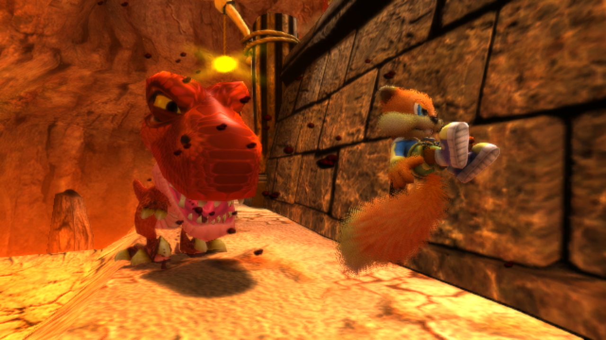
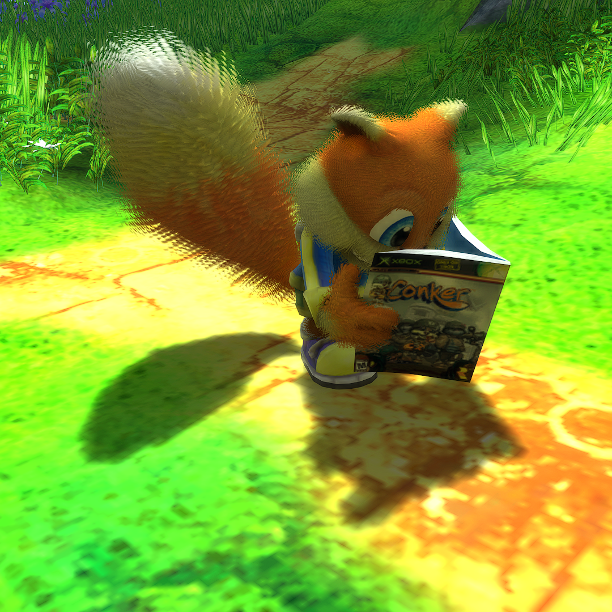
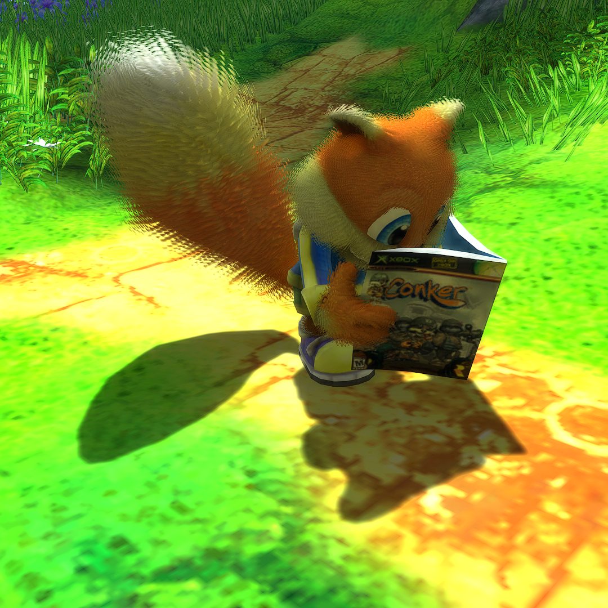
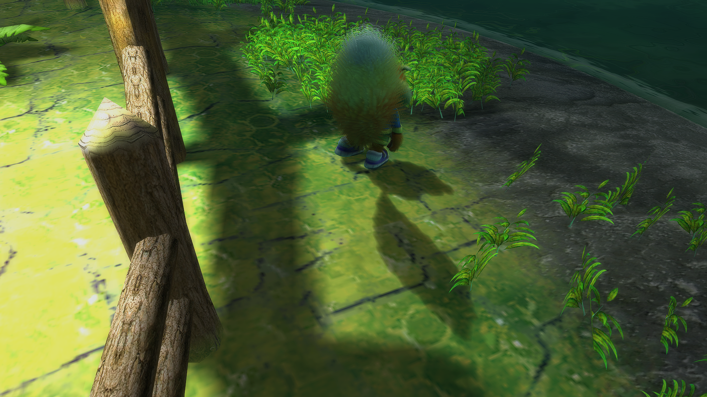
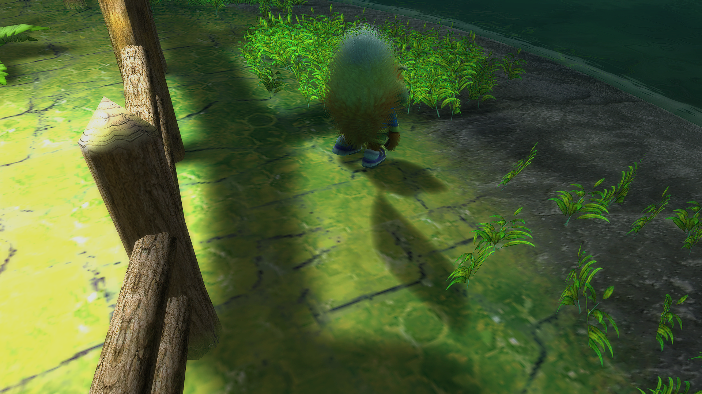
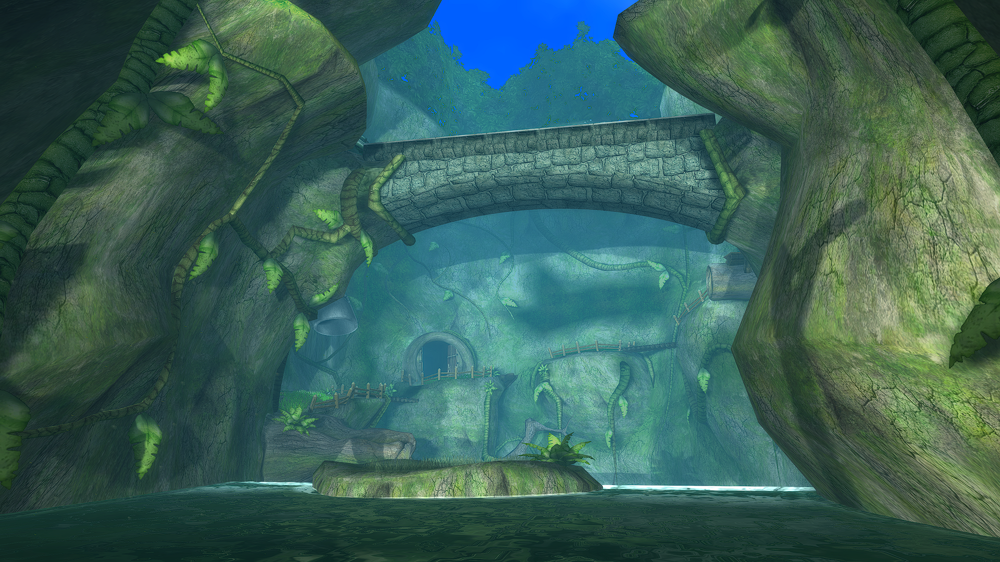
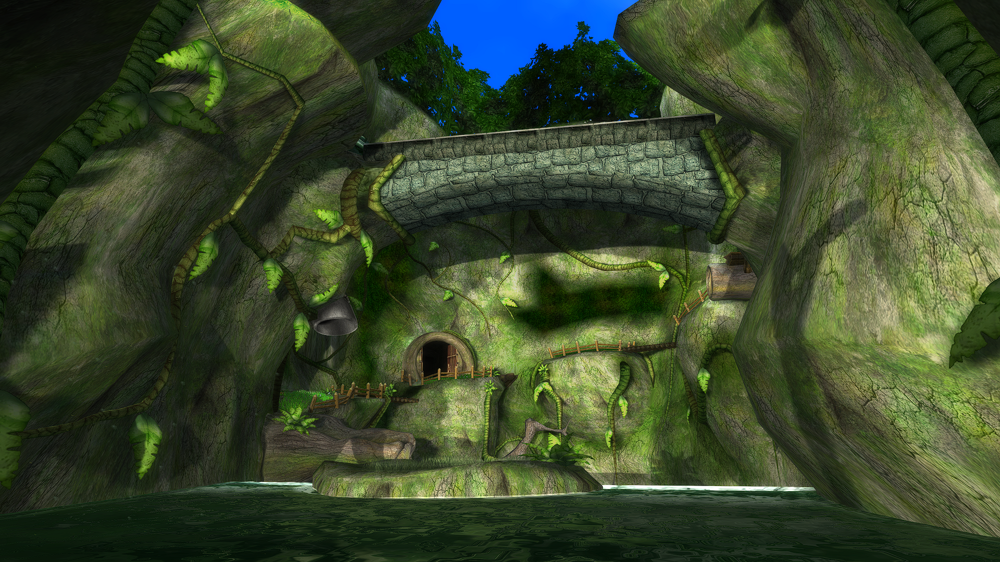
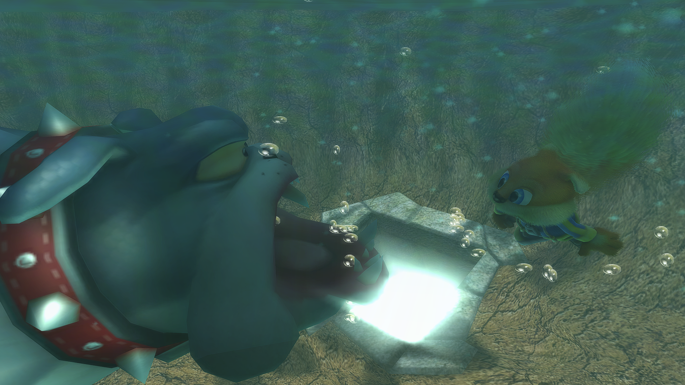
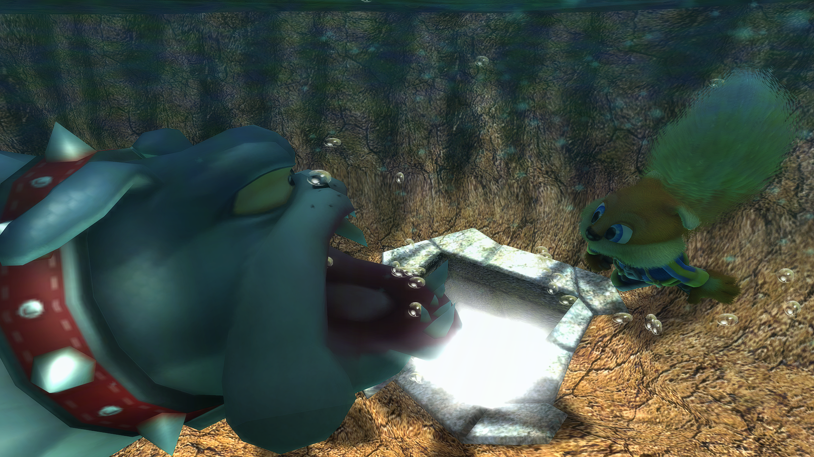
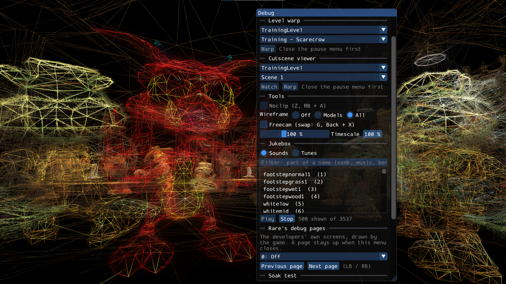

<p align="center">
  
</p>

<h1 align="center">Conker: Live & Recompiled</h1>

<p align="center">
  A native Windows PC version of <i>Conker: Live & Reloaded</i> (Xbox, 2005),<br>
  made by recompiling the original game's code. Higher resolutions, up to 120 fps,<br>
  keyboard and mouse, PlayStation controllers, photo mode and more.
</p>

<p align="center">
  <a href="../../releases/latest"><b>⬇ Download the latest release</b></a>
</p>

> **No game files are included.** You need your own copy of *Conker: Live &
> Reloaded* for the original Xbox (PAL or USA). The launcher imports it from
> your disc image.

<p align="center">
  
</p>

---

## What is this?

*Conker: Live & Reloaded* was never released natively on PC. This project translates
("statically recompiles") the game's original Xbox program into C, which is
then built as a normal Windows program. It is **not an emulator**: the game's
own logic runs natively, while a small runtime stands in for the Xbox's
operating system, graphics chip (now Direct3D 11), sound chip and
controllers.

The whole single-player story plays from start to finish, multiplayer works
against bots, and saving and loading work. It was checked frame by frame
against the real game running in xemu, and on top of that comes a long list
of PC upgrades.

### Made with AI tools

This port was made with the help of AI coding tools (such as Anthropic's
Claude Code). Most of the code was written by AI under the author's
direction; changes were tested by playing the game and by comparing it with
the real game running in xemu and various gameplay footage from Xbox, Xbox
360, and Xbox One.

## Getting started

1. Download the latest `conker-live-recompiled-<version>.zip` from
   [Releases](../../releases/latest) and unzip it anywhere (not inside
   `C:\Program Files`).
2. Start **`conker-launcher.exe`**. Windows may say *"Windows protected your
   PC"* because the programs aren't signed: click **More info → Run anyway**.
3. On the **Files** tab click **Import Files** and pick your game: a disc
   image (`.iso`, Redump or XISO), the disc's `default.xbe`, or a `.zip`,
   `.7z` or `.rar` holding either. The launcher checks it is the PAL or USA
   release and copies it in (about 4.5 GB).
4. Click **Play**.

<p align="center">
  <br>
  <i>The launcher's Files tab</i>
</p>

---

## What's new compared to the Xbox

### Picture

| | Xbox | Live & Recompiled |
|---|---|---|
| Resolution | 640×480 | Any resolution and shape (16:9, 21:9, 4:3, ...); by default your monitor's size, up to 1440p (or native, e.g. 4K) |
| Render scale | — | 0.5x–4x (10x in debug mode): supersampling above 1x, FSR 1 upscaling below |
| Frame rate | 30 fps | **30, 60, 90 or 120 fps** with the game running at its correct speed (30 fps as the original) |
| VSync | — | On, off, or G-Sync / FreeSync (VRR) |
| Display mode | — | Windowed (its size and place remembered), borderless or exclusive full screen at your monitor's refresh rate |
| Texture filtering | Original | Original, or anisotropic up to 16x |
| Character shadows | Original | Up to 16x sharper, with adjustable softness |
| World shadows | Blocky edges | Smooth |
| Anti-aliasing | — | FXAA or SMAA |
| Sharpening | — | AMD FidelityFX CAS, adjustable |
| Pop-in | Grass, fur and distant characters thin out or vanish | **Pop-in Fix**: full detail at any distance; foliage, characters, fur and ambient particle (experimental) can each be turned on or off |
| Cutscene blur (depth of field) | Original | Off, original, updated or cinematic |
| Glow | Always on | Adjustable 0–100 % |
| Fog | Always on | Distance fog and the murky underwater fog can each be turned off for a clear view |
| Haze | Always on | Can be turned off for a clear view (e.g. the green gas in some levels) |
| Vignette | Always on | Can be turned off |
| Screen drops | Always on | Water and blood drops on the screen can be turned off |
| Picture adjustments | — | Gamma, contrast, saturation |
| Retro look | — | Scanlines or CRT effect, adjustable |
| Movies | 4:3 | Kept 4:3 with black bars on a wide screen, or stretched to fill it |

<table>
  <tr>
    <th width="50%">Xbox: 640×480</th>
    <th width="50%">Live & Recompiled: 1920×1080, render scale 4x, anisotropic 16x, SMAA, shadows 16x (50 % softness), smooth world shadows</th>
  </tr>
  <tr>
    <td></td>
    <td></td>
  </tr>
  <tr>
    <td></td>
    <td></td>
  </tr>
</table>

<table>
  <tr>
    <th width="50%">Render scale 0.5x, Bilinear</th>
    <th width="50%">Render scale 0.5x, AMD FSR 1</th>
  </tr>
  <tr>
    <td></td>
    <td></td>
  </tr>
  <tr>
    <td colspan="2" align="center"><i>Both at 1280×720, drawn at 640×360 and upscaled</i></td>
  </tr>
</table>

<table>
  <tr>
    <th width="50%">Pop-in Fix off (as on the Xbox)</th>
    <th width="50%">Pop-in Fix on</th>
  </tr>
  <tr>
    <td></td>
    <td></td>
  </tr>
</table>

<table>
  <tr>
    <th width="50%">Shadows: original</th>
    <th width="50%">Shadows: 16x</th>
  </tr>
  <tr>
    <td></td>
    <td></td>
  </tr>
  <tr>
    <th>Shadows: original</th>
    <th>Smooth world shadows, shadows 8x</th>
  </tr>
  <tr>
    <td></td>
    <td></td>
  </tr>
</table>

<table>
  <tr>
    <th width="50%">Fog on (as on the Xbox)</th>
    <th width="50%">Fog off</th>
  </tr>
  <tr>
    <td></td>
    <td></td>
  </tr>
  <tr>
    <th>Underwater Fog on (as on the Xbox)</th>
    <th>Underwater Fog off</th>
  </tr>
  <tr>
    <td></td>
    <td></td>
  </tr>
</table>

<p align="center">
  <br>
  <i>The F2 settings menu (Picture tab), with the game running under it</i>
</p>

### Controls

- **Keyboard and mouse** with mouse look everywhere: on foot, aiming,
  swimming, flying as the bat and in vehicles. Every gameplay key can be
  changed (F3 menu or the launcher's Controls tab).
- Two single-player layouts: **Classic** (the controller one-to-one) and
  **Modern** (hold the right mouse button to aim, a separate action key).
- **PlayStation 4 and 5 controllers** (DualShock 4, DualSense) work directly,
  no extra programs. Xbox controllers of course too.
- **Rumble** on Xbox and PlayStation controllers, as on the Xbox, with
  rumble strength and stick dead zone set per controller.
- **Slots**: choose which controller, or the keyboard, is which player.
- Multiplayer keyboard and mouse controls, with a zoom key.
- **Back + Start** opens a small menu on the controller: settings, controls,
  photo mode and Report Bug.
- The [launcher](#the-launcher) works fully with a controller too.

<p align="center">
  <br>
  <i>The F3 controls menu</i>
</p>

### Photo mode

Press **F4** (or Back + RB) in gameplay or a cutscene to freeze the moment
and fly a free camera: zoom, roll, hide the HUD and Conker, step frame by
frame or let the world run at normal speed and freeze it again, adjust the
depth of field, and take pictures (saved as PNG files). Its panel can also
change the Pop-in Fix, haze, vignette, screen drops and CRT look for photo mode
alone. **P** freezes the game the same way, without photo mode's controls.

<p align="center">
  <br>
  <i>The photo mode panel. Photos taken with it are in <a href="#screenshots">Screenshots</a> below.</i>
</p>

### Cutscenes

Every story cutscene can be skipped, also ones you haven't seen yet and the
ones the game never lets you skip: hold the skip button (LT; Space, E or the
left mouse button) for 3 seconds. A cutscene in several parts skips one part
at a time. Or turn off Hold to Skip to skip on a press.

### On screen and extras

- **Speedrun Timer**: game time without loads from a new game, total and per
  chapter part, with or without cutscenes.
- **Input Display**: the controller drawn in a corner, showing what you press.
- **Hide HUD** and **Hide Speech Bubbles**.
- **Skip Intro**: straight to the main menu, without the logo, the intro
  movie or the walk into the bar.
- **Idle Demo** can be turned off.

### Cheats

Sixteen cheats, from God mode and infinite oxygen to Moon Jump, Big Head and
walking on water. How to get them?

> You know that fire imp? Actually, you'll find that he's, uh, context
> sensitive. And, eh, well, actually... You hold this button, and it makes
> this noise. *Ting!* Ting noise. It goes *ting*... context sensitive. He's
> sensitive to context.
>
> He's a big fan of, uh... BADFURDAY and... Konami games... yeah.
>
> In fact, it would seem to me that he can give you just what you need at
> that moment in time! (But you've gotta help him find his journal first! He lost it
> wandering through the game's files)

Or turn on [debug mode](#debug-mode), where they are all there from the start.

### Debug mode

Tick **Debug Mode** on the launcher's **Debug** tab (or start
`conker.exe --debug`) for a Debug menu (F8) and a console (`~`): level warp,
a cutscene viewer, noclip, freecam, wireframe, game speed, Edit Save (move a
save to any chapter), a jukebox of the game's sounds and music, Rare's own
debug pages, and every cheat without its code. Everything it does is in
[DEBUG_MODE.md](DEBUG_MODE.md). It's a testing tool: back up your saves
first.

<p align="center">
  <br>
  <i>The Debug menu (F8), with the whole scene in wireframe</i>
</p>

### Loading

- **Fast Load** (experimental, off by default): loads no longer wait for the
  old level's music to fade out, so they take under a second instead of 3 to
  8 seconds.
- **Precompile Shaders** (launcher, Files tab): prepares the shaders of every
  story level and chapter in one go (a few minutes, once), so the short pauses
  the first time you see an area are mostly gone.

### Sound

- Volume and mute for **Music**, **Effects**, **Dialogue** and **Other**
  (ambience and menus) besides the master volume, and a **Cutscene volume**
  (0–200 %) for everything heard in cutscenes.
- The Xbox's sound chip emulated as in xemu, for the original mix, with sound
  effects no longer louder than the music (xemu's mix plays 3D sounds too loud).
- Speaker mix and 3D sound (HRTF) options.
- Sound can be silenced while paused.

### Language

Text, menus and subtitles in English, French, German, Italian, Spanish or
Japanese, chosen in F2 or the launcher (on the Xbox it followed the
console's language). Voices are English in all of them.

### Uncensored

With the fan-made [decensor patch](https://github.com/nastys/conker-live-and-reloaded-decensor)
(by nastys, Vaani and Theconker64; downloaded by the launcher if you want it):
cutscene voices and songs without the bleeps, and uncensored text.

<p align="center">
  <br>
  <i>The Great Mighty Poo song, uncensored</i>
</p>

### Fixes to the original game

A few glitches the Xbox version has too are fixed:

- Characters' mouths no longer stay open after quick lines of speech.
- Smoke, fire and glows no longer show through barbed wire in front of them.
- Sounds no longer end early when the game is paused.
- A character no longer lies half inside the floor in a late cutscene.
- The game keeps its normal speed when it slows down, instead of speeding up.
- The pause screen's Quit? Yes / No works with the D-pad and arrow keys.
- The hole in the fire imp's back at the main menu is closed, and the soldier
  who loses his arm in It's War is no longer see-through.

### The launcher

- Imports the game from a disc image, folder or archive (`.zip`, `.7z`,
  `.rar`, multi-part included), and checks it is a supported release.
- Every in-game setting and control before you start, in the same tabs as
  the game's menus.
- **Works with a controller**: every tab, setting and button by pad, with
  on-screen button hints.
- Its own **file browser** for choosing your game or the patch, by mouse,
  keyboard or controller; or drag the file from Explorer onto it.
- **Precompile Shaders** (see [Loading](#loading)), and **Delete Shaders** to
  clear them again.
- **Updates itself**: when a new version is out, one click installs it and
  keeps your game files and patch.
- Keeps your saves, settings and photos next to the game (or in AppData if
  you prefer), and moves saves from older versions over by itself.
- Buttons to open your saves, photos and logs, and **Report Bug** for a crash
  you notice later.
- A resizable window, or full screen with **F11** (or `--fullscreen`) for
  TVs and handhelds.
- A **Debug** tab: [debug mode](#debug-mode) on or off, and Edit Save.

<table>
  <tr>
    <th width="50%">Settings tab</th>
    <th width="50%">Controls tab</th>
  </tr>
  <tr>
    <td></td>
    <td></td>
  </tr>
</table>

### For modders

- **Texture replacement**: PNG files in a `textures\` folder next to the game
  replace the game's textures, matched by a hash of each texture.

---

## Requirements

- Windows 10 or 11, 64-bit
- A graphics card with DirectX 11
- Your own copy of *Conker: Live & Reloaded* (Xbox; PAL or USA)
- About 6 GB of free space
- Optional: an Xbox or PlayStation controller (keyboard and mouse work too)

Windows "N" editions need Microsoft's Media Feature Pack for the game's movies.

## Keys in the game

| Key | Controller | |
|---|---|---|
| F2 | Back + LB | Settings menu |
| F3 | | Controls menu |
| F4 | Back + RB | Photo mode |
| | Back + Start | Menu: settings, controls, photo mode, Report Bug |
| F8 | | Cheat menu, once unlocked (Debug menu in [debug mode](#debug-mode)) |
| `~` | | Console ([debug mode](#debug-mode) only) |
| F10 | Report Bug... button in the settings menu | Report a bug |
| F11 or Alt+Enter | | Full screen on/off |
| F1 | | Frame rate counter |
| P | | Pause or resume (gameplay and cutscenes) |
| Esc (main menu) | B (main menu) | Close the game (asks first) |
| Space, E or left mouse (hold) | LT (hold) | Skip a cutscene |

Saves, settings, photos and logs are in the `userdata` folder next to `conker.exe` (from 0.1.3; the launcher's Files tab can keep them in `%LOCALAPPDATA%\conker-lr-recomp\` instead, where older versions kept them).

## Planned features

Ideas for future updates, in no particular order. Plans can change.

- Linux / Steam Deck support
- Frame rates above 120 fps
- Accurate audio DSP emulation + expanded sound profiles
- Mouse controls for menus
- Gyro aiming
- HD-friendly GUI / expanded button prompts
- Improved water and fluids
- Achievements
- Working online play (via System Link emulation)
- Expanded multiplayer features

## Known issues

- Xbox Live and System Link are not available (multiplayer against bots works).
- The first time an area is seen, a short pause can happen while the graphics
  card prepares it; it is remembered for next time. The launcher's
  **Precompile Shaders** prepares the story's shaders ahead.

Found something else? Press **F10** in the game (or **Report Bug** on the
launcher's Files tab), say what happened and open an [issue](../../issues)
with the `.zip` it makes. It holds the game's logs, a picture of the moment,
your settings and, if you leave them ticked, your saves; the Windows user name
is left out. After a crash the game offers this by itself, and F10 still works
if the game has frozen.

## Building from source

The recompiled game code is never published: building means running the
toolkit's pipeline on your own copy of the game, which translates its
`default.xbe` into C on your PC.

You need:

- Windows 10 or 11, 64-bit, with [Git](https://git-scm.com/)
- Visual Studio 2022 with the **Desktop development with C++** workload
  (includes CMake and Ninja)
- [Python 3.12](https://www.python.org/) and [PowerShell 7](https://github.com/PowerShell/PowerShell)
- The [.NET 10 SDK](https://dotnet.microsoft.com/) (only for the launcher)
- Your game's files: the `game\` folder the launcher imported, or the
  disc extracted with [xdvdfs](https://github.com/antangelo/xdvdfs)

Then, with `<game>` standing for the folder that holds `default.xbe`:

```bat
git clone --recurse-submodules https://github.com/cdetv/conker-live-recompiled.git
cd conker-live-recompiled
py -3.12 -m venv .venv
.venv\Scripts\python -m pip install capstone
pwsh scripts\pipeline.ps1 -GameDir <game>
```

The pipeline takes about 10 minutes and writes the C code to
`src\recomp\gen\`. Then, in an **x64 Native Tools Command Prompt for VS
2022**:

```bat
cmake -S . -B build -G "Ninja Multi-Config" -DCONKER_GAME_DIR=<game>
cmake --build build --config Release
dotnet publish launcher -c Release -o build\launcher
```

The game is `build\Release\conker.exe` (with `xemu_apu.dll` beside it; it
finds the game files through a link to `<game>`), the launcher
`build\launcher\conker-launcher.exe`. Building the game takes about 15
minutes.

## Credits

- **[xboxrecomp](https://github.com/sp00nznet/xboxrecomp)** by Ned Heller
  (sp00nznet) and contributors: the recompilation toolkit and runtime this is
  built on (used through the fork [cdetv/xboxrecomp](https://github.com/cdetv/xboxrecomp)).
- **[xemu](https://github.com/xemu-project/xemu)**: the sound chip emulation,
  and the reference the port was checked against.
- **nastys, Vaani and Theconker64**: [the decensor patch](https://github.com/nastys/conker-live-and-reloaded-decensor).
- **[giacomozama/live-and-recompiled](https://github.com/giacomozama/live-and-recompiled)**:
  another Conker recompilation whose change log pointed us at frame-rate bugs
  (barn roof, swimming height, Harbour cannons).
- **[codepdbh/xboxrecomp-conker](https://github.com/codepdbh/xboxrecomp-conker)**,
  the *[Conker Xbox 60fps + Widescreen patch](https://www.moddb.com/mods/conker-live-reloaded-wip-60fps-patch)
  by picardsfish*, **[XboxDev/ghidra-xbe](https://github.com/XboxDev/ghidra-xbe)**
  and **[Ghidra](https://github.com/nationalsecurityagency/ghidra)**: knowledge
  and tools along the way.
- Dear ImGui, SDL3, AMD FidelityFX CAS and FSR 1, NVIDIA FXAA, SMAA, .NET,
  Avalonia, CommunityToolkit.Mvvm and SharpCompress.

Full licences: [`LICENSE.txt`](LICENSE.txt) (this project, MIT) and
[`THIRD_PARTY_NOTICES.txt`](THIRD_PARTY_NOTICES.txt).

## Legal

This project contains no game assets and no original game files. You must
own the game to play. *Conker: Live & Reloaded*, *Conker* and *Xbox* are
trademarks of Microsoft Corporation / Rare Ltd. This project is not
affiliated with or endorsed by Microsoft or Rare.

## Screenshots

Taken with photo mode at 1920×1080 in v0.1.0.

<table>
  <tr>
    <td width="50%"></td>
    <td width="50%"></td>
  </tr>
  <tr>
    <td></td>
    <td></td>
  </tr>
  <tr>
    <td></td>
    <td></td>
  </tr>
  <tr>
    <td></td>
    <td></td>
  </tr>
  <tr>
    <td></td>
    <td></td>
  </tr>
</table>
