<p align="center">
  
</p>

<h1 align="center">Conker: Live & Recompiled</h1>

<p align="center">
  A native Windows PC version of <i>Conker: Live & Reloaded</i> (Xbox, 2005),<br>
  made by recompiling the original game's code. Higher resolutions, up to 120 fps,<br>
  keyboard and mouse, an unlocked camera, photo mode and more.<br>
  Also runs on Linux and the Steam Deck.
</p>

<p align="center">
  <a href="../../releases/latest"><b>⬇ Download the latest release</b></a>
</p>

> **No game files are included.** You need your own copy of *Conker: Live &
> Reloaded*: the original Xbox disc (PAL or USA) or the Xbox Store version.
> The launcher imports it from your disc image or the installed Store copy.

<p align="center">
  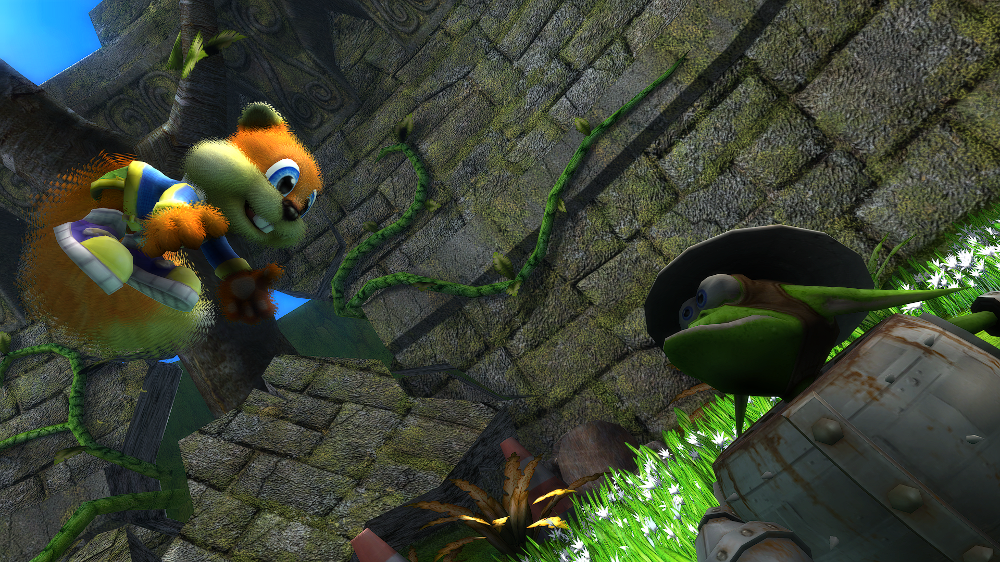
</p>

---

## What is this?

*Conker: Live & Reloaded* was never released natively on PC. This project translates
("statically recompiles") the game's original Xbox program into C, which is
then built as a normal Windows program. It is **not an emulator**: the game's
own logic runs natively, while a small runtime stands in for the Xbox's
operating system, graphics chip (now Direct3D 11), sound chip and
controllers.

The whole single-player story plays from start to finish, multiplayer works
against bots, and saving and loading work. It was checked frame by frame
against the real game running in xemu, and on top of that comes a long list
of PC upgrades.

### Made with AI tools

This port was made with the help of AI coding tools (such as Anthropic's
Claude Code). Most of the code was written by AI under the author's
direction; changes were tested by playing the game and by comparing it with
the real game running in xemu and various gameplay footage from Xbox, Xbox
360, and Xbox One.

## Getting started

1. Download the latest `conker-live-recompiled-<version>.zip` from
   [Releases](../../releases/latest) and unzip it anywhere (not inside
   `C:\Program Files`).
2. Start **`conker-launcher.exe`**. Windows may say *"Windows protected your
   PC"* because the programs aren't signed: click **More info → Run anyway**.
3. On the **Files** tab click **Import Files** and pick your game: a disc
   image (`.iso`, Redump or XISO), the disc's `default.xbe`, or a `.zip`,
   `.7z` or `.rar` holding either. The launcher checks it is the PAL or USA
   release and copies it in (about 4.5 GB).
   Got the **Xbox Store version**? Install it from the Xbox app; the launcher
   finds it by itself: click **Import Xbox Store version**.
4. Click **Play**.

Playing through Steam? **Add to Steam** on the **Files** tab adds the launcher
to your Steam library as a non-Steam game, with artwork from
[SteamGridDB](https://www.steamgriddb.com/) (Steam closes for a moment if it
is open, then starts again).

On Linux or a Steam Deck, see [Linux and Steam Deck](#linux-and-steam-deck) below.

<p align="center">
  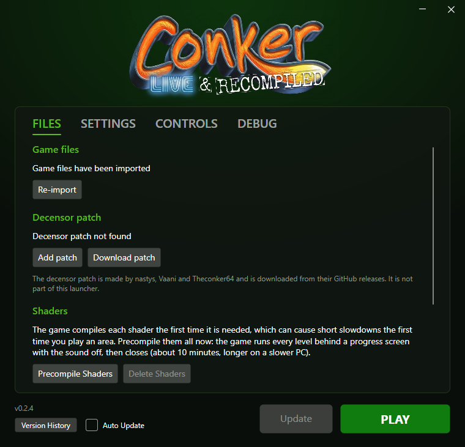<br>
  <i>The launcher's Files tab</i>
</p>

## Linux and Steam Deck

The same download runs on Linux and the Steam Deck through Steam's **Proton 11**.
It was tested on a Steam Deck LCD, in Desktop Mode and Gaming Mode. Other Linux
PCs with Steam should work the same way: tell us how it goes in an
[issue](../../issues). Other ways of running Windows programs (Wine, Lutris,
Bottles) haven't been tested.

**Setting it up** (on a Steam Deck in Desktop Mode: Steam button → Power →
Switch to Desktop):

1. Unpack `conker-live-recompiled-<version>.zip` into a folder of its own,
   for example `~/Games/Conker` (the internal drive or a microSD card), and
   copy your disc image onto the Deck.
2. **Add it to Steam**: in that folder, double-click **`add-to-steam.sh`** and
   choose **Execute** (or press **F4** in the file manager for a terminal and
   type `bash add-to-steam.sh`). It closes Steam, adds `conker-launcher.exe`
   as *Conker: Live & Recompiled* with **Proton 11.0** forced and its artwork
   from SteamGridDB, then starts Steam again. Running it again updates the
   same entry; after moving the folder, run it from the new place.
   <details><summary>Or add it by hand</summary>

   In Steam: **Games → Add a Non-Steam Game to My Library → Browse**, set the
   file type to **All Files**, pick **`conker-launcher.exe`** in that folder
   and click **Add Selected Programs**. Then right-click it in your library →
   **Properties → Compatibility**: tick **Force the use of a specific Steam
   Play compatibility tool** and choose **Proton 11.0**.
   </details>
3. Start it from Steam and import your game on the **Files** tab, as on
   Windows. In the file browser your home folder is `Z:` → `home` → your user
   name (`deck` on a Steam Deck), and a Deck's microSD card is `D:`. The Xbox
   Store version installs only on Windows: import it there and copy the whole
   folder over.
4. Click **Play**. From now on it starts from your Steam library like any
   game, in Gaming Mode too: the launcher first, then **Play**. **Back +
   Start → Close Game** takes you back to Steam.

To go straight into the game, add `conker.exe` by hand (with Proton 11.0
too); the launcher is still there for settings, Precompile Shaders and
updates.

**On the Steam Deck:**

- The first start picks the **Medium** quality preset at **60 fps**. For a
  longer battery life set Steam's **Framerate Limit** (Performance menu): at
  40 the Deck's chip uses about half the power it does at 60. Or choose
  **30 fps** in F2 → Graphics: in busy scenes it uses about a quarter less
  power.
- Run **Precompile Shaders** once (launcher, Files tab; about 7 minutes).
  Without it the first minute or so stutters while the shaders are made;
  after it, only the very first walk into the main menu stutters for a few
  seconds.
- The Deck's controls work as an Xbox controller with Steam's default
  layout, and touch works in the launcher and the game's menus. **Back +
  Start** (the ⧉ and ☰ buttons) opens a menu with settings, controls, photo
  mode, **Report Bug** and **Close Game**; **Back + LB** opens the F2
  settings menu; **Steam + X** shows Steam's keyboard.
- The right trackpad is a mouse only while the Steam button is held; the
  **Gamepad with Mouse Trackpad** layout (the shortcut's controller
  settings) makes it one all the time.
- **Gyro aiming** with a PlayStation controller: in the shortcut's
  **Properties → Controller** choose **Disable Steam Input**.
- In Desktop Mode Steam's keyboard opens *behind* a full-screen game: set F2
  → Display → **Display mode** to **Windowed** before typing a bug report.
  Gaming Mode is fine.

Saves, settings, photos and logs are in `userdata` inside the game's folder,
as on Windows (Steam doesn't back them up). Something wrong? **Back + Start →
Report Bug** makes the same `.zip` as on Windows, with the Linux details
included.

---

## What's new compared to the Xbox

### Picture

| | Xbox | Live & Recompiled |
|---|---|---|
| Quality preset | — | **Low, Medium, High or Ultra** sets the main picture options in one go; a weaker PC starts on Low |
| Resolution | 640×480 | Any resolution and shape (16:9, 21:9, 4:3, ...); by default your monitor's size, up to 1440p (or native, e.g. 4K) |
| Render scale | — | 0.5x–4x (10x in debug mode): supersampling above 1x, FSR 1 upscaling below; **Automatic resolution** lowers it by itself when your graphics card can't keep up |
| Frame rate | 30 fps | **30, 60, 90 or 120 fps** with the game running at its correct speed (30 fps as the original) |
| VSync | — | On, off, or G-Sync / FreeSync (VRR) |
| Display mode | — | Windowed (its size and place remembered), borderless or exclusive full screen at your monitor's refresh rate |
| Texture filtering | Original | Original, or anisotropic up to 16x |
| Character shadows | Original | Up to 16x sharper, with adjustable softness |
| World shadows | Blocky edges | Smooth |
| Anti-aliasing | — | FXAA or SMAA |
| Sharpening | — | AMD FidelityFX CAS, adjustable |
| Character & foliage detail | Grass, fur and distant characters thin out or vanish | **Extended**: full detail at any distance (grass and flowers, characters, fur and ambient particles (experimental) can each be turned on or off), and distant characters keep their full model twice as far; **Original** as on the Xbox; **Low** for a weaker PC |
| Cutscene blur (depth of field) | Original | Off, original, updated or cinematic |
| Glow | Always on | Adjustable 0–100 % |
| Fog | Always on | Distance fog and the murky underwater fog can each be turned off for a clear view |
| Haze | Always on | Can be turned off for a clear view (e.g. the green gas in some levels) |
| Vignette | Always on | Can be turned off |
| Screen drops | Always on | Water and blood drops on the screen can be turned off |
| Picture adjustments | — | Gamma, contrast, saturation |
| Retro look | — | Scanlines or CRT effect, adjustable |
| Movies | 4:3 | Kept 4:3 with black bars on a wide screen, or stretched to fill it |
| Cutscenes | 4:3 | As wide as your screen, or in their original 4:3 with black bars |

<table>
  <tr>
    <th width="50%">Xbox: 640×480</th>
    <th width="50%">Live & Recompiled: 1920×1080, render scale 4x, anisotropic 16x, SMAA, shadows 16x (50 % softness), smooth world shadows</th>
  </tr>
  <tr>
    <td>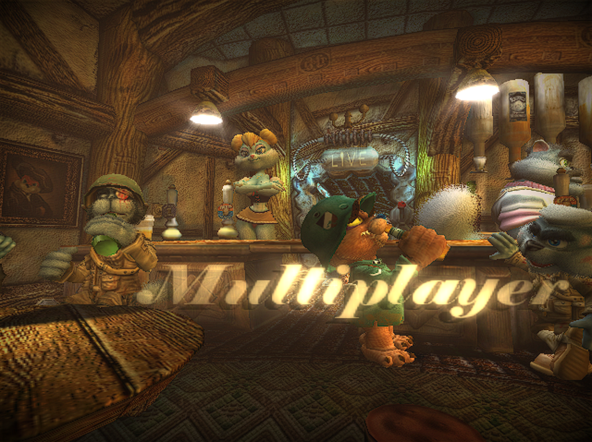</td>
    <td>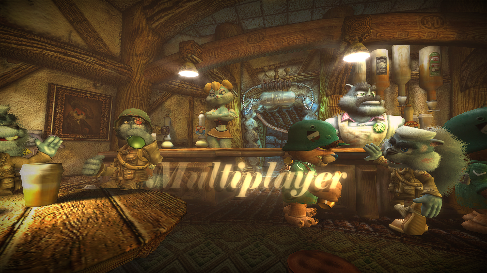</td>
  </tr>
  <tr>
    <td>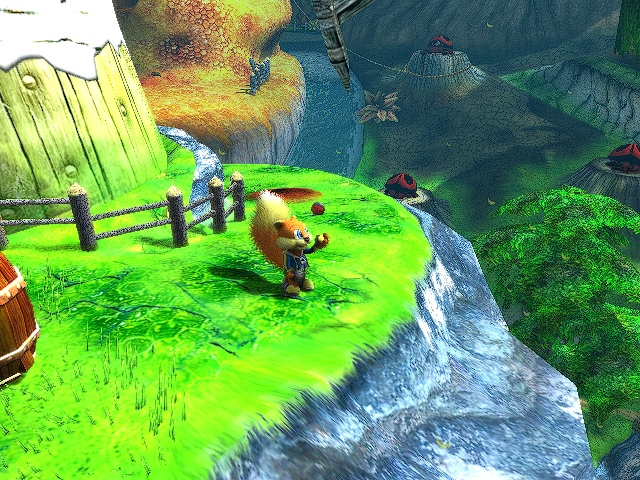</td>
    <td>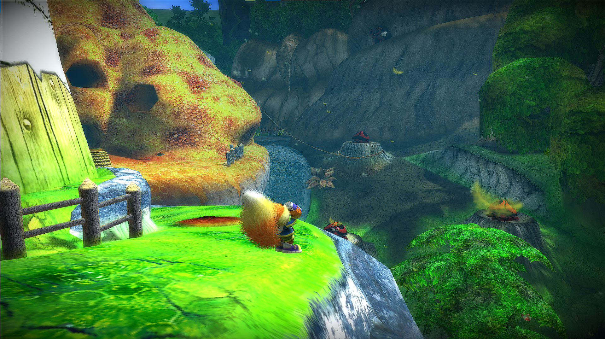</td>
  </tr>
</table>

<table>
  <tr>
    <th width="50%">Render scale 0.5x, Bilinear</th>
    <th width="50%">Render scale 0.5x, AMD FSR 1</th>
  </tr>
  <tr>
    <td>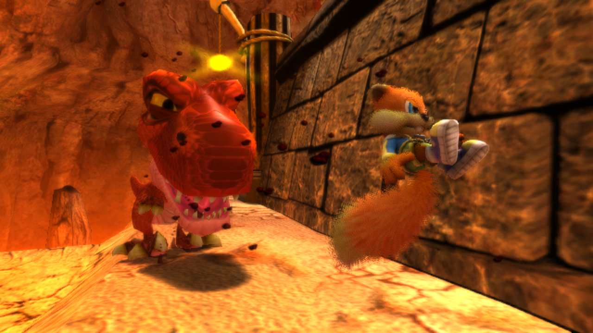</td>
    <td></td>
  </tr>
  <tr>
    <td colspan="2" align="center"><i>Both at 1280×720, drawn at 640×360 and upscaled</i></td>
  </tr>
</table>

<table>
  <tr>
    <th width="50%">Character & foliage detail: Original (as on the Xbox)</th>
    <th width="50%">Character & foliage detail: Extended</th>
  </tr>
  <tr>
    <td>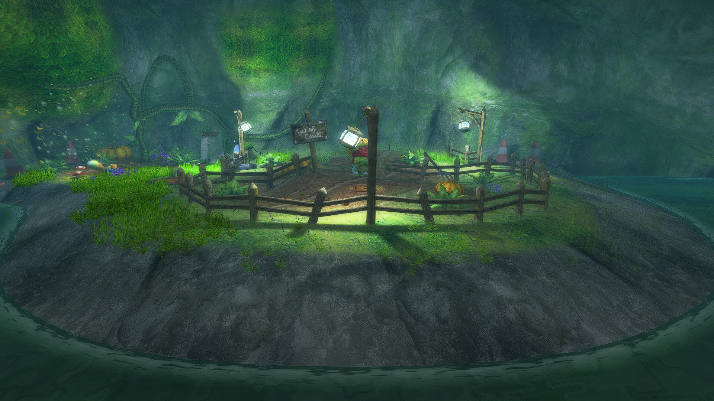</td>
    <td>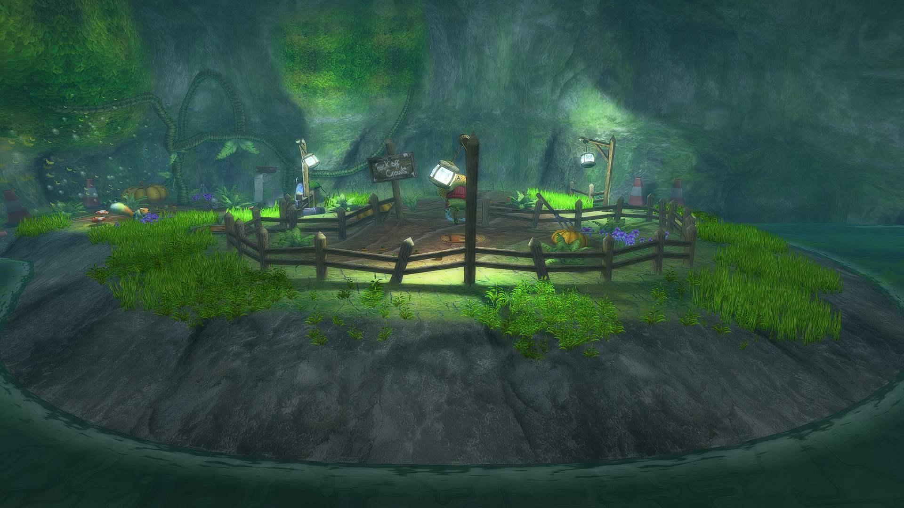</td>
  </tr>
</table>

<table>
  <tr>
    <th width="50%">Shadows: original</th>
    <th width="50%">Shadows: 16x</th>
  </tr>
  <tr>
    <td>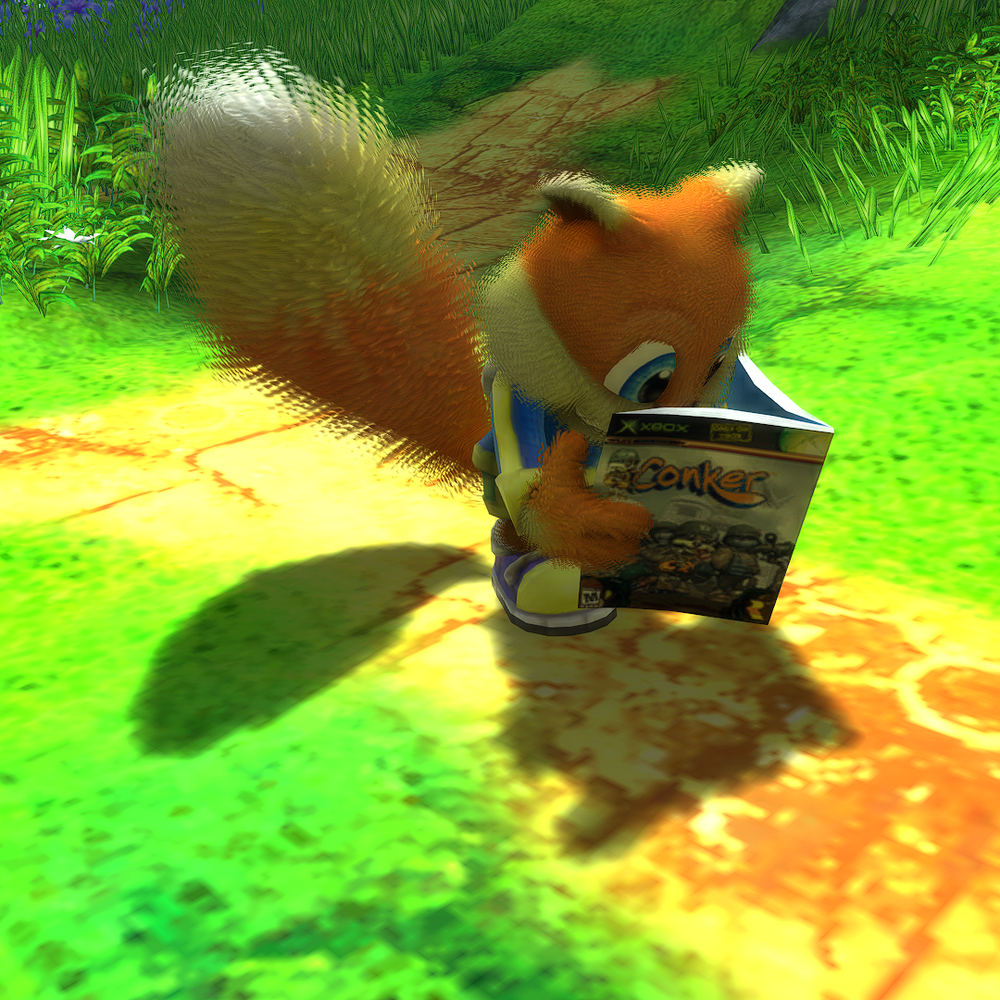</td>
    <td>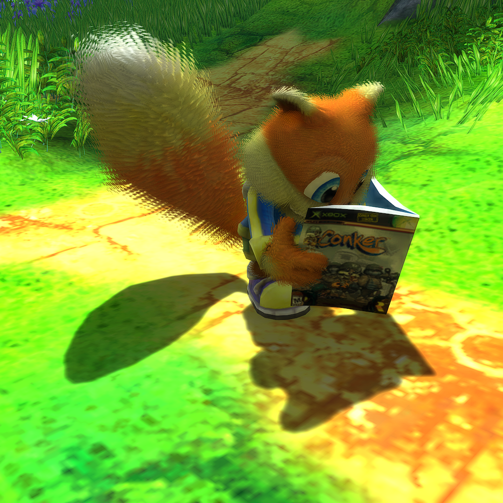</td>
  </tr>
  <tr>
    <th>Shadows: original</th>
    <th>Smooth world shadows, shadows 8x</th>
  </tr>
  <tr>
    <td>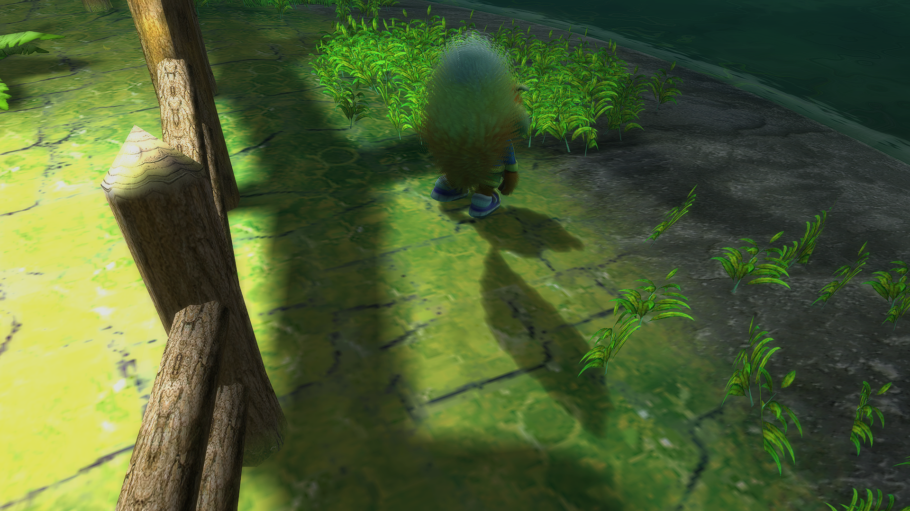</td>
    <td>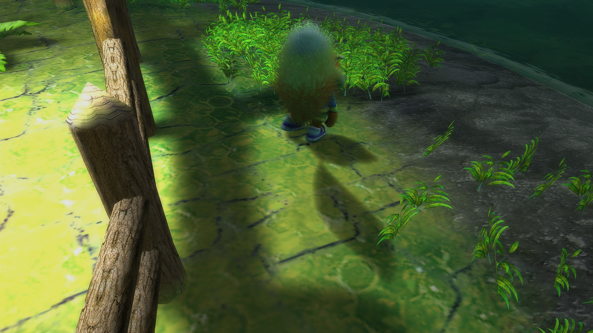</td>
  </tr>
</table>

<table>
  <tr>
    <th width="50%">Fog on (as on the Xbox)</th>
    <th width="50%">Fog off</th>
  </tr>
  <tr>
    <td>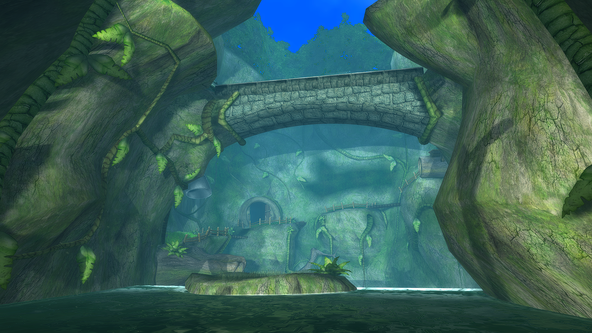</td>
    <td>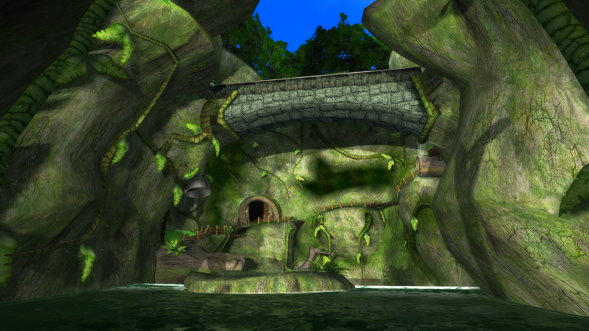</td>
  </tr>
  <tr>
    <th>Underwater Fog on (as on the Xbox)</th>
    <th>Underwater Fog off</th>
  </tr>
  <tr>
    <td>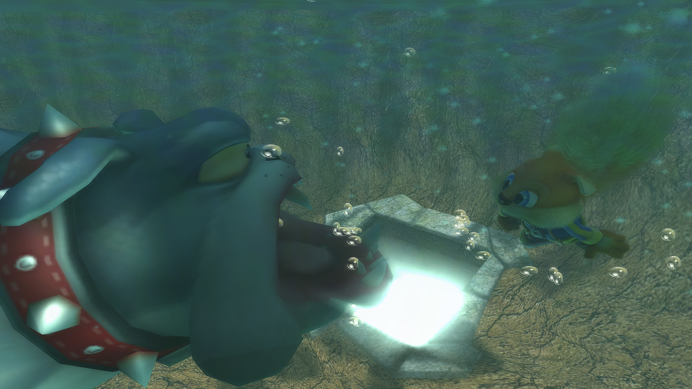</td>
    <td>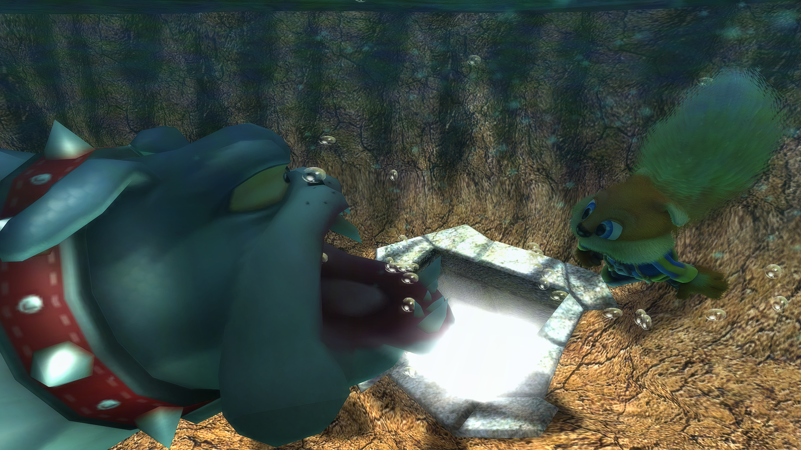</td>
  </tr>
</table>

<p align="center">
  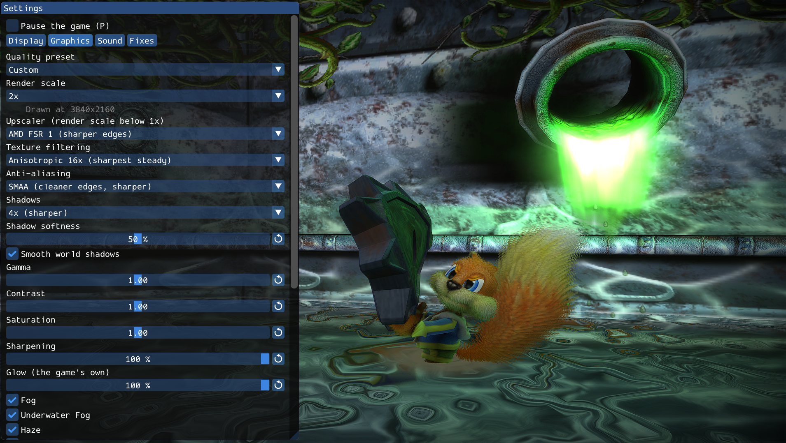<br>
  <i>The F2 settings menu (Graphics tab), with the game running under it</i>
</p>

### Controls

- **Keyboard and mouse** with mouse look everywhere: on foot, aiming,
  swimming, flying as the bat and in vehicles. Every gameplay key can be
  changed (F3 menu or the launcher's Controls tab), with up to three keys per
  action and two-key combos such as Shift + E.
- **Controller buttons** can be changed too: every single-player action gets
  the button you choose, with Classic and Modern each keeping their own set
  (F3 menu or the launcher's Controls tab).
- **Mouse in menus**: point and click in the game's own menus, from the main
  menu (drag the room around by hand) and the pause screen to every
  multiplayer menu. Touchscreens work too, without the mouse cursor showing
  (F2 → Display → **Show cursor for touch** brings it back).
- Two single-player layouts: **Classic** (the controller one-to-one) and
  **Modern** (hold the right mouse button to aim, a separate action key).
- **PlayStation 4 and 5 controllers** (DualShock 4, DualSense) and **Switch
  controllers** (Pro Controller, a pair of Joy-Cons) work directly, no extra
  programs. Xbox controllers of course too.
- **Gyro aiming** with PlayStation and Switch controllers: turn the
  controller to aim.
- **Rumble** as on the Xbox, and **Controller Options** for each controller:
  rumble strength, stick dead zone, camera speeds and gyro aiming.
- **Slots**: choose which controller, or the keyboard, is which player.
- Multiplayer keyboard and mouse controls, with a zoom key.
- **Back + Start** opens a small menu on the controller: settings, controls,
  photo mode, Report Bug, controller options and Close Game.
- **Chords**: the controller's button pairs for these extras (Back + Start,
  Back + LB, Back + RB...) can be changed in F3 > Slots > Chords.
- The [launcher](#the-launcher) works fully with a controller too.

<p align="center">
  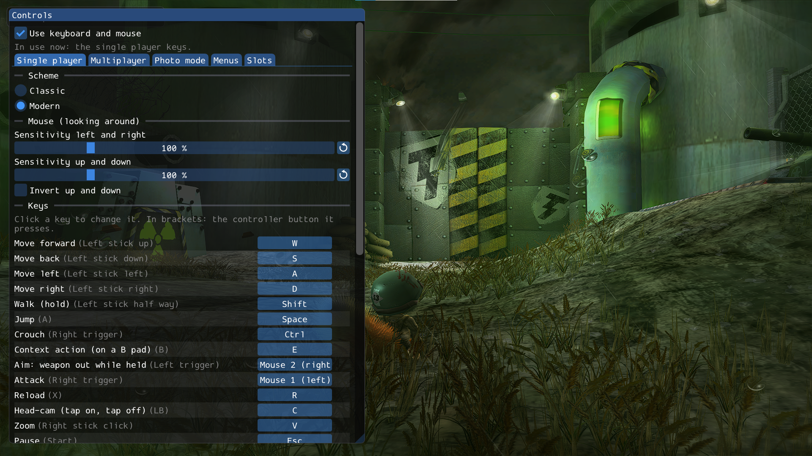<br>
  <i>The F3 controls menu</i>
</p>

### Camera

- **Unlocked Camera** (on by default): tilt the camera from straight down on
  Conker to looking up at what's above him (the Xbox stopped just short of
  level), with the right stick or the mouse. Zoom smoothly with the mouse
  wheel or D-pad up + right stick; the zoom button (right stick click / V)
  puts the camera back behind Conker. The bat, frying pan, Vault suit, SMG and
  shotgun keep their own close view, with a slight zoom of their own.
- **Field of view** from 40° to 75° (50° as on the Xbox); story cutscenes keep
  their own.

### Extras

Options that change the game itself, in F2 → **Extras** (and the launcher's
Settings tab). All are off by default, as the original, and none is kept in
your saves, so you can switch them on and off at any time. Single player only.

**Melee**:

- **Quick Swing**: hold attack to keep swinging. **Normal** repeats the first
  two hits (a press in time still gives the uppercut), **Easy** all three.
- **Forgiving Combo**: a press made a little too early waits for its moment
  instead of breaking the combo.
- **Fast Weapon Draw**: every weapon comes out and goes away 2.5 times as fast.
- **Camera Switch**: the camera button (right stick click, V) switches between
  the normal camera and over the shoulder, with nothing out or with the bat or
  frying pan out; drawing them never changes the view.
- **Swing While Jumping**: the bat or frying pan swings in the air too, combo
  included, and the jump keeps its arc.

**Unload Reloaded** undoes some of what *Live & Reloaded* changed. The
checkbox beside its title turns on all of it at once (Weapon Frying Pan with
Update Cutscene, Milk Fix, No Key Goblings and Free Swing), and off again:

- **Weapon**: **Bat** gives Conker the bat from the start, in the training
  too; **Frying Pan** keeps the frying pan all game long; **Both** is the game
  as it was (the frying pan in the training, then the bat). It changes at the
  next draw. With **Update Cutscene** the training's weapon scenes match: with
  the bat, Conker takes the bat off the rack and the gargoyle scene starts at
  the uppercut; with the frying pan, the gargoyle scene goes from his first
  line straight to the uppercut.
- **Milk Fix**: in the opening scene King Conker holds a glass of milk instead
  of the jewelled goblet, as on the N64.
- **No Key Goblings**: in the training cave the key hops out after the
  frying-pan tutorial, with no goblins, as in the N64 game.
- **Free Swing**: the controller's Reload button (X) or the keyboard's Attack
  key (left mouse button) takes the bat or frying pan out and swings at once;
  it goes away as soon as the swinging is over, and the camera stays free.

The frying pan and the glass of milk are made from your own game files when
the game first starts.

### Photo mode

Press **F4** (or Back + RB) in gameplay or a cutscene to freeze the moment
and fly a free camera: zoom, roll, hide the HUD and Conker, step frame by
frame or let the world run at normal speed and freeze it again, adjust the
depth of field, and take pictures (saved as PNG files). Its panel can also
change Character & foliage detail, haze, vignette, screen drops and CRT look for photo mode
alone. **P** freezes the game the same way, without photo mode's controls.

<p align="center">
  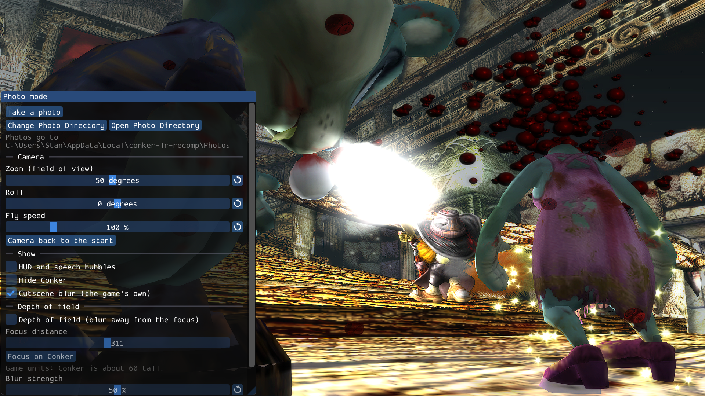<br>
  <i>The photo mode panel. Photos taken with it are in <a href="#screenshots">Screenshots</a> below.</i>
</p>

### Cutscenes

Every story cutscene can be skipped, also ones you haven't seen yet and the
ones the game never lets you skip: hold the skip button (LT; Space, E or the
left mouse button) for 3 seconds. A cutscene in several parts skips one part
at a time. Or turn off Hold to Skip to skip on a press.

On a wide screen, cutscenes fill it like the rest of the game, or turn on
**Cutscenes in 4:3** to watch them in their original shape with black bars.

### On screen and more

- **Speedrun Timer**: game time without loads from a new game, total and per
  chapter part, with or without cutscenes.
- **Input Display**: the controller drawn in a corner, showing what you press.
- **Hide HUD** and **Hide Speech Bubbles**.
- **Skip Intro**: straight to the main menu, without the logo, the intro
  movie or the walk into the bar.
- **Idle Demo** can be turned off.

### Cheats

Eighteen cheats, from God mode and infinite oxygen to Moon Jump, Big Head,
walking on water, and Conker as a tiny mouse or a big bear. How to get them?

> You know that fire imp? Actually, you'll find that he's, uh, context
> sensitive. And, eh, well, actually... You hold this button, and it makes
> this noise. *Ting!* Ting noise. It goes *ting*... context sensitive. He's
> sensitive to context.
>
> He's a big fan of, uh... BADFURDAY and... Konami games... yeah.
>
> In fact, it would seem to me that he can give you just what you need at
> that moment in time! (But you've gotta help him find his journal first! He lost it
> wandering through the game's files)

Or turn on [debug mode](#debug-mode), where they are all there from the start.

### Debug mode

Tick **Debug Mode** on the launcher's **Debug** tab (or start
`conker.exe --debug`) for a Debug menu (F8) and a console (`~`): level warp,
a cutscene viewer, noclip, freecam, wireframe, game speed, Edit Save (move a
save to any chapter), a jukebox of the game's sounds and music, Rare's own
debug pages, every cheat without its code, and console scripts for testing
(button presses, waits, screenshots, story flags). Everything it does is in
[DEBUG_MODE.md](DEBUG_MODE.md). It's a testing tool: back up your saves
first.

<p align="center">
  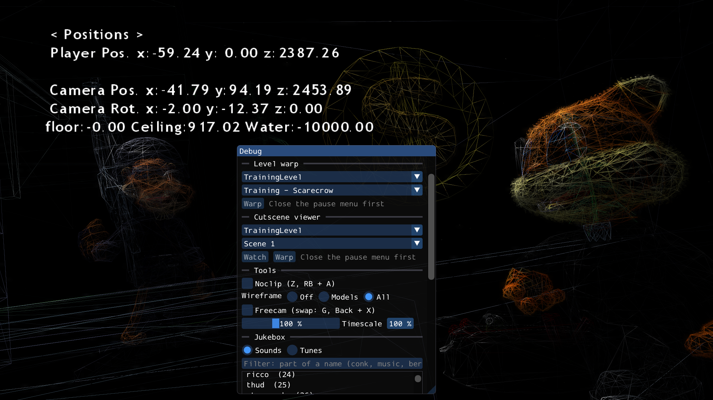<br>
  <i>The Debug menu (F8), with the whole scene in wireframe</i>
</p>

### Loading

- **Fast Load** (on by default; F2 → Fixes): loads no longer wait for the
  old level's music to fade out, so they take under a second instead of 3 to
  8 seconds. Turn it off for the original wait.
- **Precompile Shaders** (launcher, Files tab): prepares the shaders of every
  story level and chapter in one go (a few minutes, once), so the short pauses
  the first time you see an area are mostly gone.

### Sound

- Volume and mute for **Music**, **Effects**, **Dialogue** and **Other**
  (ambience and menus) besides the master volume, and a **Cutscene volume**
  (0–200 %) for everything heard in cutscenes.
- **Full DSP** (the default): the effects the Xbox's sound chip adds (speaker
  crosstalk, filters, and the reverb when the game asks for it) made the way
  the console makes them. **Standard** is the sound of earlier versions (the
  sound chip as in xemu); the two switch at once.
- **Output**: **Stereo**, **Headphones** (3D sounds straight into each ear),
  **5.1 surround** (six speakers, or headphones through Windows Sonic or Dolby
  Atmos for Headphones) or **Mono** (both sides the same, for one ear or one
  speaker).
- A **speaker test** that plays a sound on each speaker in turn.
- **Enhanced room reverb** (off by default): room sound in caves, halls, the
  sewer and other rooms from the game's own reverb presets, and under-water
  sound while Conker is under water, with a strength slider. The original never
  turns its reverb on in story mode.
- Sound effects no longer louder than the music (xemu's mix plays 3D sounds too
  loud), and sound can be silenced while paused.

### Language

Text, menus and subtitles in English, French, German, Italian, Spanish or
Japanese, chosen in F2 or the launcher (on the Xbox it followed the
console's language). Voices are English in all of them.

This port's own menus (F2, F3, photo mode) come in the same six languages:
**Menu language** follows the text language, or pick one of its own. They are
machine translations using the game's own words; corrections from native
speakers are welcome in an [issue](../../issues).

### Uncensored

With the fan-made [decensor patch](https://github.com/nastys/conker-live-and-reloaded-decensor)
(by nastys, Vaani and Theconker64; downloaded by the launcher if you want it):
cutscene voices and songs without the bleeps, and uncensored text.

<p align="center">
  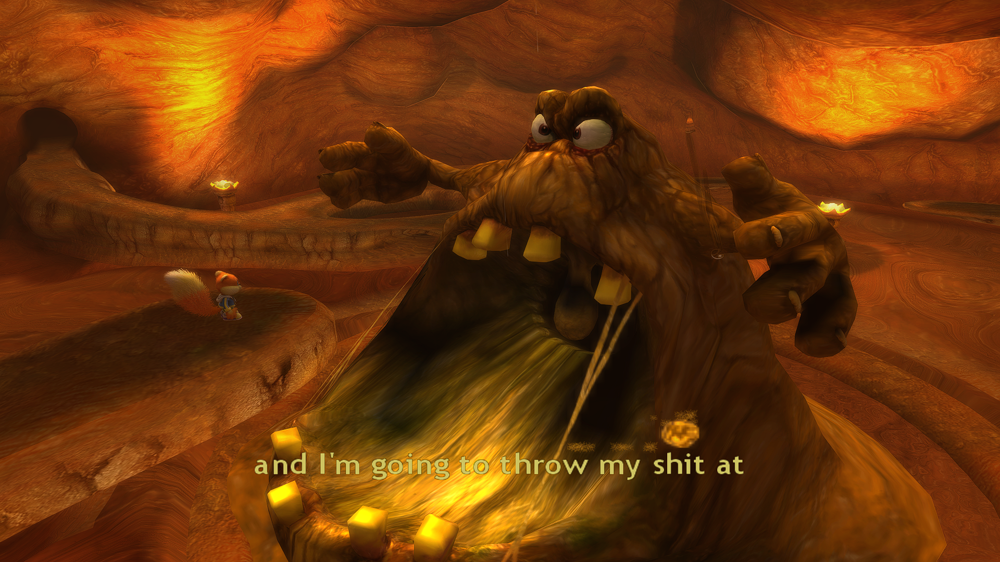<br>
  <i>The Great Mighty Poo song, uncensored</i>
</p>

### Fixes to the original game

A few glitches the Xbox version has too are fixed:

- Characters' mouths no longer stay open after quick lines of speech.
- Smoke, fire and glows no longer show through barbed wire in front of them.
- Sounds no longer end early when the game is paused.
- A character no longer lies half inside the floor in a late cutscene.
- The game keeps its normal speed when it slows down, instead of speeding up.
- The pause screen's Quit? Yes / No works with the D-pad and arrow keys.
- The hole in the fire imp's back at the main menu is closed, and the soldier
  who loses his arm in It's War is no longer see-through.

### The launcher

- Imports the game from a disc image, folder or archive (`.zip`, `.7z`,
  `.rar`, multi-part included), or the installed **Xbox Store version**
  (found by itself, one click), and checks it is a supported release.
- **Prepares game assets**: a few seconds after an import, it reads the parts
  of your game files that some features need ahead (with the port's own
  package reader); they stay with your saves, and **Delete Assets** clears them.
- Every in-game setting and control before you start, in the same tabs as
  the game's menus, with the same quality presets.
- **Works with a controller**: every tab, setting and button by pad, with
  on-screen button hints.
- Its own **file browser** for choosing your game or the patch, by mouse,
  touch, keyboard or controller; or drag the file from Explorer onto it.
- **Precompile Shaders** (see [Loading](#loading)), and **Delete Shaders** to
  clear them again.
- **Updates itself**: when a new version is out, one click installs it and
  keeps your game files and patch.
- Keeps your saves, settings and photos next to the game (or in AppData if
  you prefer), and moves saves from older versions over by itself.
- Buttons to open your saves, photos and logs, and **Report Bug** for a crash
  you notice later.
- A resizable window, or full screen with **F11** (or `--fullscreen`) for
  TVs and handhelds.
- A **Debug** tab: [debug mode](#debug-mode) on or off, and Edit Save.
- **Add to Steam**: the launcher in your Steam library as a non-Steam game,
  with its artwork, in one click (on Linux and the Steam Deck,
  `add-to-steam.sh` does the same, with Proton 11 set).

<table>
  <tr>
    <th width="50%">Settings tab (Graphics)</th>
    <th width="50%">Controls tab</th>
  </tr>
  <tr>
    <td>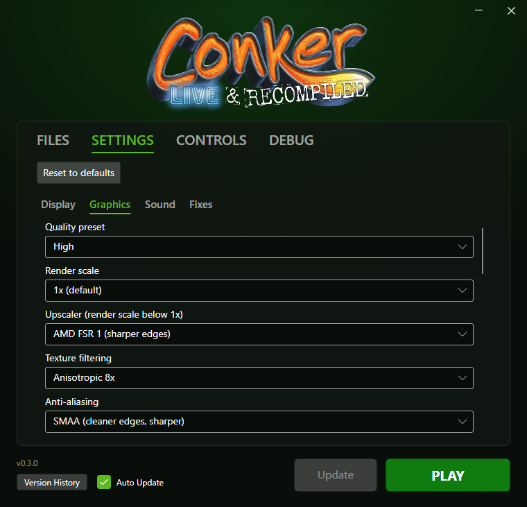</td>
    <td>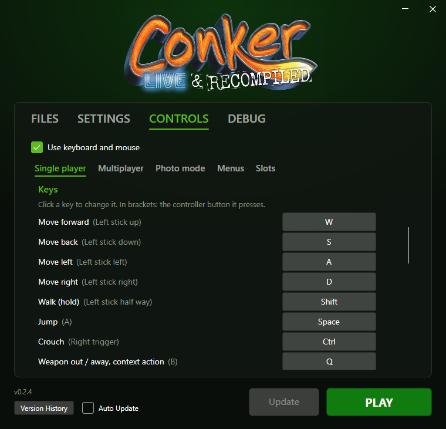</td>
  </tr>
</table>

### For modders

- **Texture replacement**: PNG files in a `textures\` folder next to the game
  replace the game's textures, matched by a hash of each texture.

---

## Requirements

- Windows 10 or 11, 64-bit; or Linux or a Steam Deck with Steam's Proton 11
  ([Linux and Steam Deck](#linux-and-steam-deck))
- A graphics card with DirectX 11 (on Linux: Vulkan)
- Your own copy of *Conker: Live & Reloaded*: the original Xbox disc (PAL or
  USA) or the Xbox Store version
- About 6 GB of free space
- Optional: an Xbox, PlayStation or Switch controller (keyboard and mouse work too)

Windows "N" editions need Microsoft's Media Feature Pack for the game's movies.

## Keys in the game

The controller's button pairs are the defaults: F3 > Slots > Chords changes them.

| Key | Controller | |
|---|---|---|
| F2 | Back + LB | Settings menu |
| F3 | | Controls menu |
| F4 | Back + RB | Photo mode |
| | Back + Start | Menu: settings, controls, photo mode, Report Bug, controller options, Close Game |
| F8 | | Cheat menu, once unlocked (Debug menu in [debug mode](#debug-mode)) |
| `~` | | Console ([debug mode](#debug-mode) only) |
| F10 | Report Bug... button in the settings menu | Report a bug |
| F11 or Alt+Enter | | Full screen on/off |
| F1 | | Frame rate counter (press again for frame times, a third time for what limits your frame rate) |
| P | | Pause or resume (gameplay and cutscenes) |
| Mouse wheel | D-pad up + right stick | Zoom the camera in or out ([Unlocked Camera](#camera)) |
| V | Right stick click | Put the camera back behind Conker ([Unlocked Camera](#camera)) |
| Esc (main menu) | B (main menu) | Close the game (asks first) |
| Space, E or left mouse (hold) | LT (hold) | Skip a cutscene |

Saves, settings, photos and logs are in the `userdata` folder next to `conker.exe` (from 0.1.3; the launcher's Files tab can keep them in `%LOCALAPPDATA%\conker-lr-recomp\` instead, where older versions kept them).

## Planned features

Ideas for future updates, in no particular order. Plans can change.

- Frame rates above 120 fps
- HD-friendly GUI / expanded button prompts
- Improved water and fluids
- Achievements
- Working online play (via System Link emulation)
- Expanded multiplayer features

## Known issues

- Xbox Live and System Link are not available (multiplayer against bots works).
- The first time an area is seen, a short pause can happen while the graphics
  card prepares it; it is remembered for next time. The launcher's
  **Precompile Shaders** prepares the story's shaders ahead.

Found something else? Press **F10** in the game (or **Report Bug** on the
launcher's Files tab), say what happened and open an [issue](../../issues)
with the `.zip` it makes. It holds the game's logs, a picture of the moment,
your settings and, if you leave them ticked, your saves; the Windows user name
is left out. After a crash the game offers this by itself, and F10 still works
if the game has frozen.

## Building from source

The recompiled game code is never published: building means running the
toolkit's pipeline on your own copy of the game, which translates its
`default.xbe` into C on your PC.

You need:

- Windows 10 or 11, 64-bit, with [Git](https://git-scm.com/)
- Visual Studio 2022 with the **Desktop development with C++** workload
  (includes CMake and Ninja)
- [Python 3.12](https://www.python.org/) and [PowerShell 7](https://github.com/PowerShell/PowerShell)
- The [.NET 10 SDK](https://dotnet.microsoft.com/) (only for the launcher)
- Your game's files: the `game\` folder the launcher imported, or the
  disc extracted with [xdvdfs](https://github.com/antangelo/xdvdfs)

Then, with `<game>` standing for the folder that holds `default.xbe`:

```bat
git clone --recurse-submodules https://github.com/cdetv/conker-live-recompiled.git
cd conker-live-recompiled
py -3.12 -m venv .venv
.venv\Scripts\python -m pip install capstone
pwsh scripts\pipeline.ps1 -GameDir <game>
```

The pipeline takes about 10 minutes and writes the C code to
`src\recomp\gen\`. Then, in an **x64 Native Tools Command Prompt for VS
2022**:

```bat
cmake -S . -B build -G "Ninja Multi-Config" -DCONKER_GAME_DIR=<game>
cmake --build build --config Release
dotnet publish launcher -c Release -o build\launcher
```

The game is `build\Release\conker.exe` (with `xemu_apu.dll` beside it; it
finds the game files through a link to `<game>`), the launcher
`build\launcher\conker-launcher.exe`. Building the game takes about 15
minutes.

## Credits

- **[xboxrecomp](https://github.com/sp00nznet/xboxrecomp)** by Ned Heller
  (sp00nznet) and contributors: the recompilation toolkit and runtime this is
  built on (used through the fork [cdetv/xboxrecomp](https://github.com/cdetv/xboxrecomp)).
- **[xemu](https://github.com/xemu-project/xemu)**: the sound chip emulation,
  and the reference the port was checked against.
- **nastys, Vaani and Theconker64**: [the decensor patch](https://github.com/nastys/conker-live-and-reloaded-decensor).
- **[giacomozama/live-and-recompiled](https://github.com/giacomozama/live-and-recompiled)**:
  another Conker recompilation whose change log pointed us at frame-rate bugs
  (barn roof, swimming height, Harbour cannons) and at the fixes in 0.3.3 (the
  censor box, Creaky Crate and Heist dive at high frame rates, the squirrel
  soldiers' tails, fur, the English throne-room bubbles and BrontoThroat's
  music).
- **[yacineolivier-maker/ConkerLR-Recomp](https://github.com/yacineolivier-maker/ConkerLR-Recomp)**:
  the Full DSP sound effects (speaker crosstalk, filters, reverb) follow their
  effect code (MIT); thank you.
- **[Txukie/xboxrecomp-conker](https://github.com/Txukie/xboxrecomp-conker)**:
  the package reader's resource extraction follows their `conker_caff.c`,
  and the [Extras](#extras)' Frying Pan, the Milk Fix's glass of milk and Free
  Swing follow their weapon, intro and Swing Button code (all MIT). They
  worked out how a single model can be written as a loose file; thank you.
- **[codepdbh/xboxrecomp-conker](https://github.com/codepdbh/xboxrecomp-conker)**,
  the *[Conker Xbox 60fps + Widescreen patch](https://www.moddb.com/mods/conker-live-reloaded-wip-60fps-patch)
  by picardsfish*, **[XboxDev/ghidra-xbe](https://github.com/XboxDev/ghidra-xbe)**
  and **[Ghidra](https://github.com/nationalsecurityagency/ghidra)**: knowledge
  and tools along the way.
- Dear ImGui, SDL3, GamepadMotionHelpers, AMD FidelityFX CAS and FSR 1, NVIDIA FXAA, SMAA, .NET,
  Avalonia, CommunityToolkit.Mvvm and SharpCompress.
- The Steam artwork that **Add to Steam** downloads from
  [SteamGridDB](https://www.steamgriddb.com/) (not part of this download):
  [cover](https://www.steamgriddb.com/grid/866446),
  [wide cover](https://www.steamgriddb.com/grid/866445) and
  [logo](https://www.steamgriddb.com/logo/186060) shared by **PopASquatt**,
  [background](https://www.steamgriddb.com/hero/8418) by **Jiquita**,
  [icon](https://www.steamgriddb.com/icon/10449) by **EVE Online**.

Full licences: [`LICENSE.txt`](LICENSE.txt) (this project, MIT) and
[`THIRD_PARTY_NOTICES.txt`](THIRD_PARTY_NOTICES.txt).

## Legal

This project contains no game assets and no original game files. You must
own the game to play. *Conker: Live & Reloaded*, *Conker* and *Xbox* are
trademarks of Microsoft Corporation / Rare Ltd. This project is not
affiliated with or endorsed by Microsoft or Rare.

## Screenshots

Taken with photo mode at 1920×1080 in v0.1.0.

<table>
  <tr>
    <td width="50%">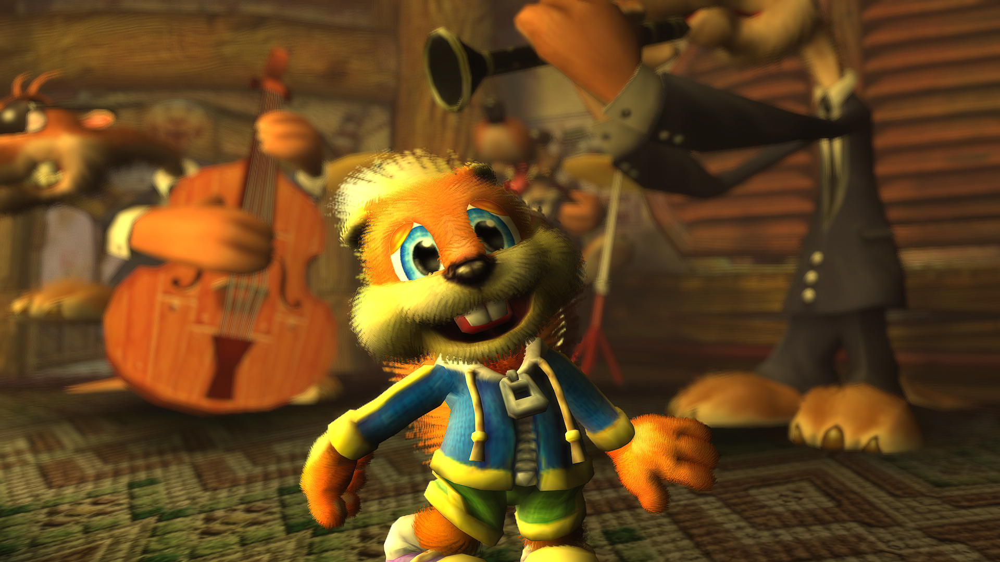</td>
    <td width="50%">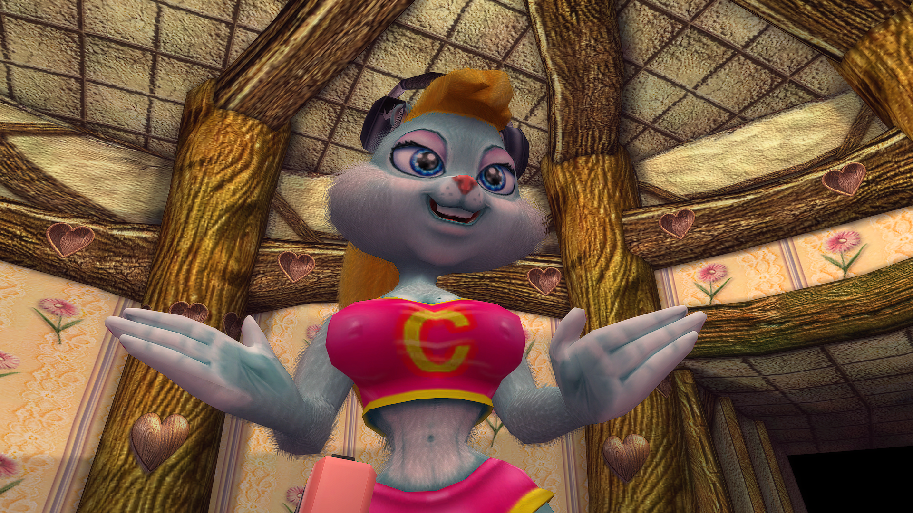</td>
  </tr>
  <tr>
    <td>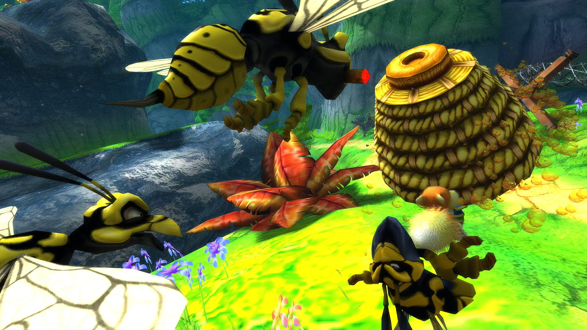</td>
    <td>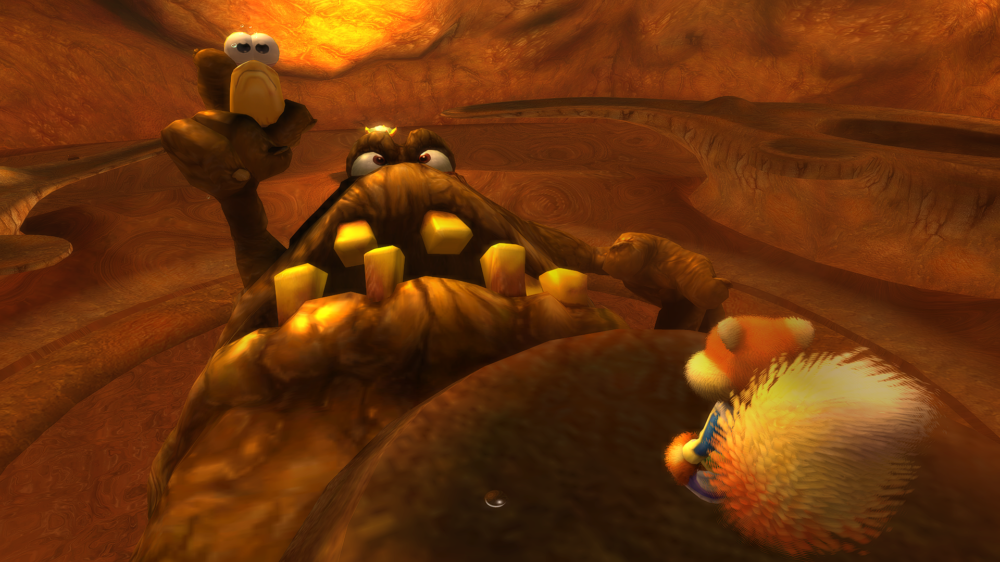</td>
  </tr>
  <tr>
    <td>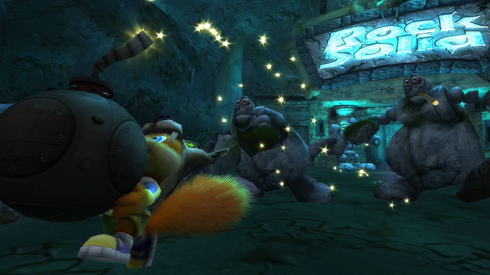</td>
    <td>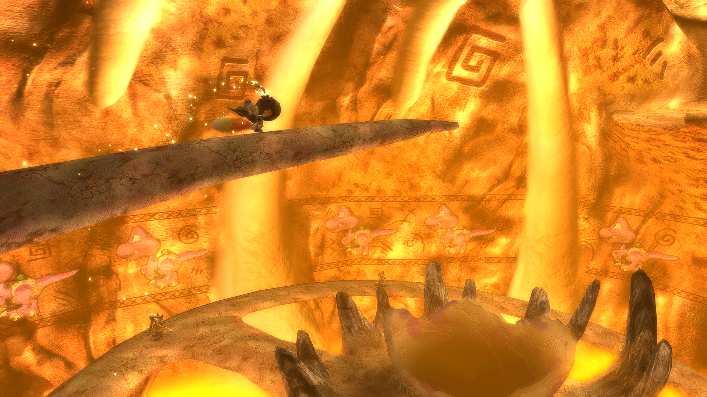</td>
  </tr>
  <tr>
    <td>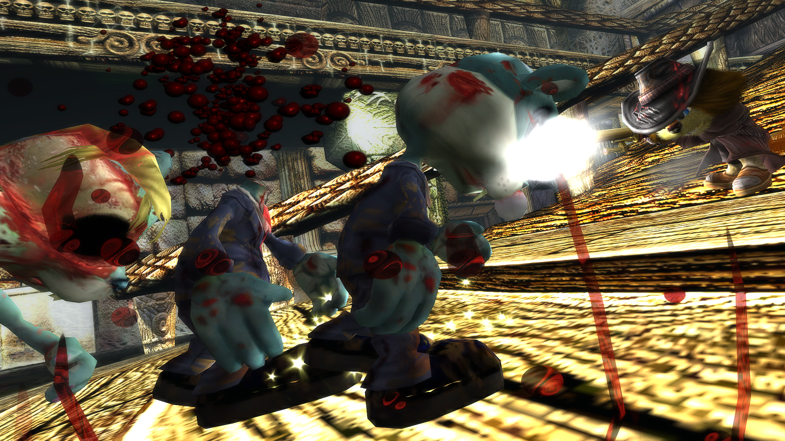</td>
    <td>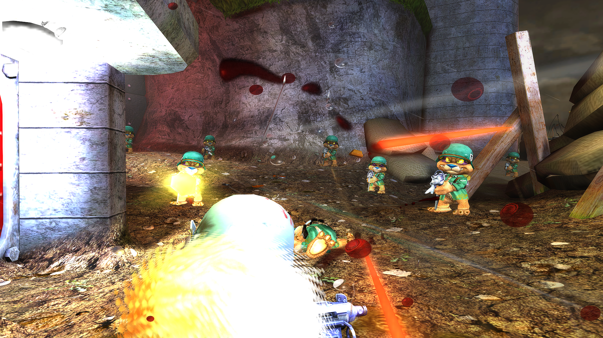</td>
  </tr>
  <tr>
    <td>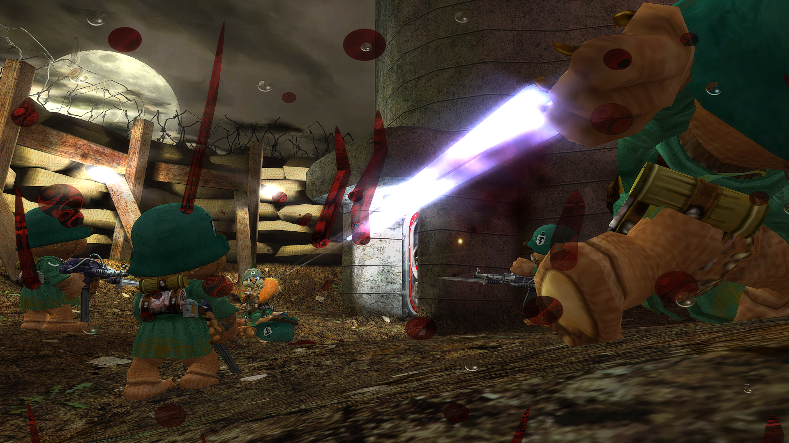</td>
    <td>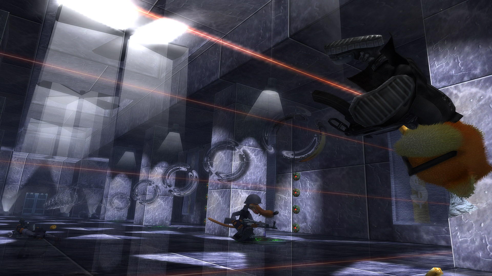</td>
  </tr>
</table>
