<!--
  Draft of the public repo's front page (SPEC 9.4). Copy to the root of
  cdetv/conker-live-recompiled; the images go in images/ beside it there,
  never in this private repo (SPEC 3.3). They are staged (untracked) in
  _work/public_repo/images/: the user's screenshots (hero.png at the top) from
  D:\Claude\Resources\ConkerXboxRecompile\Readme Screenshots\, with
  Conker-Recompiled-Logo-noTM.png renamed to logo.png (same as art/logo.png).
-->

<p align="center">
  
</p>

<h1 align="center">Conker: Live & Recompiled</h1>

<p align="center">
  A native Windows PC version of <i>Conker: Live & Reloaded</i> (Xbox, 2005),<br>
  made by recompiling the original game's code. Higher resolutions, 60 fps,<br>
  keyboard and mouse, PlayStation controllers, photo mode and more.
</p>

<p align="center">
  <a href="../../releases/latest"><b>⬇ Download the latest release</b></a>
</p>

> **No game files are included.** You need your own copy of *Conker: Live &
> Reloaded* for the original Xbox (PAL or USA). The launcher imports it from
> your disc image.

<p align="center">
  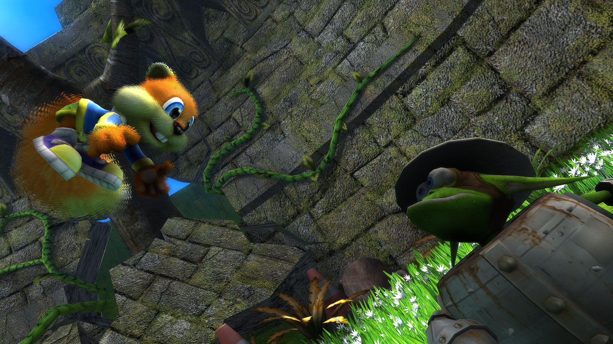
</p>

---

## What is this?

*Conker: Live & Reloaded* was never released on PC. This project translates
("statically recompiles") the game's original Xbox program into C, which is
then built as a normal Windows program. It is **not an emulator**: the game's
own logic runs natively, while a small runtime stands in for the Xbox's
operating system, graphics chip (now Direct3D 11), sound chip and
controllers.

The whole single-player story plays from start to finish, multiplayer works
against bots, and saving and loading work. It was checked frame by frame
against the real game running in xemu, and on top of that comes a long list
of PC upgrades.

### Made with AI tools

This port was made with the help of AI coding tools (such as Anthropic's
Claude Code). Most of the code was written by AI under the author's
direction; changes were tested by playing the game and by comparing it with
the real game running in xemu and various gameplay footage from Xbox, Xbox
360, and Xbox One.

## Getting started

1. Download the latest `conker-live-recompiled-<version>.zip` from
   [Releases](../../releases/latest) and unzip it anywhere (not inside
   `C:\Program Files`).
2. Start **`conker-launcher.exe`**. Windows may say *"Windows protected your
   PC"* because the programs aren't signed: click **More info → Run anyway**.
3. On the **Files** tab click **Import Files** and pick your game: a disc
   image (`.iso`, Redump or XISO), the disc's `default.xbe`, or a `.zip`,
   `.7z` or `.rar` holding either. The launcher checks it is the PAL or USA
   release and copies it in (about 4.5 GB).
4. Click **Play**.

<p align="center">
  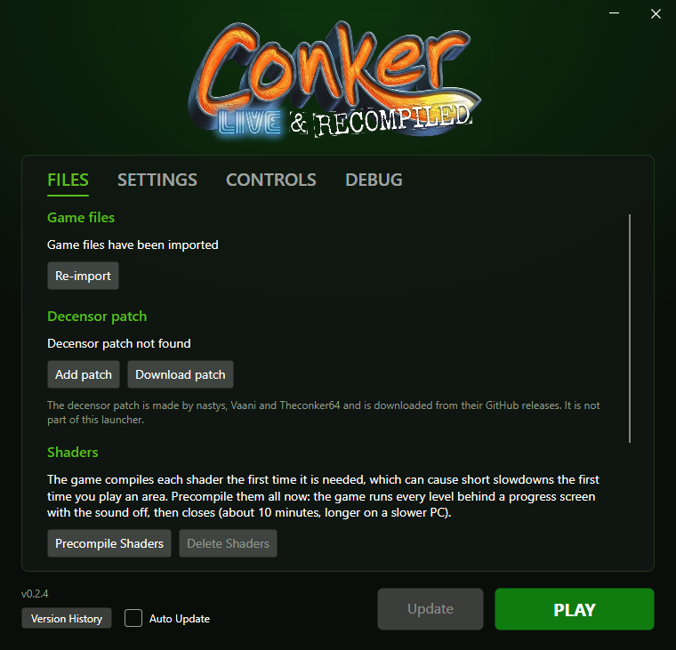<br>
  <i>The launcher's Files tab</i>
</p>

---

## What's new compared to the Xbox

### Picture

| | Xbox | Live & Recompiled |
|---|---|---|
| Resolution | 640×480 | Any resolution and shape (16:9, 21:9, 4:3, ...); by default your monitor's size, up to 1440p (or native, e.g. 4K) |
| Render scale | — | 50–200 %: supersampling above 100 %, FSR 1 upscaling below |
| Frame rate | 30 fps | **60 fps** with the game running at its correct speed (30 fps available as the original) |
| Texture filtering | Original | Original, or anisotropic up to 16x |
| Anti-aliasing | — | FXAA or SMAA |
| Sharpening | — | AMD FidelityFX CAS, adjustable |
| Pop-in | Grass, fur and distant characters thin out or vanish | **Pop-in Fix**: full detail at any distance |
| Cutscene blur (depth of field) | Original | Off, original, updated or cinematic |
| Glow | Always on | Adjustable 0–100 % |
| Haze | Always on | Can be turned off for a clear view (e.g. the green gas in some levels) |
| Picture adjustments | — | Gamma, contrast, saturation |
| Retro look | — | Scanlines or CRT effect, adjustable |

<table>
  <tr>
    <th width="50%">Xbox: 640×480</th>
    <th width="50%">Live & Recompiled: 1920×1080, every setting maxed out</th>
  </tr>
  <tr>
    <td>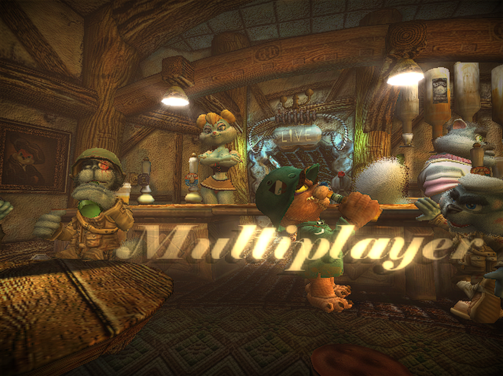</td>
    <td>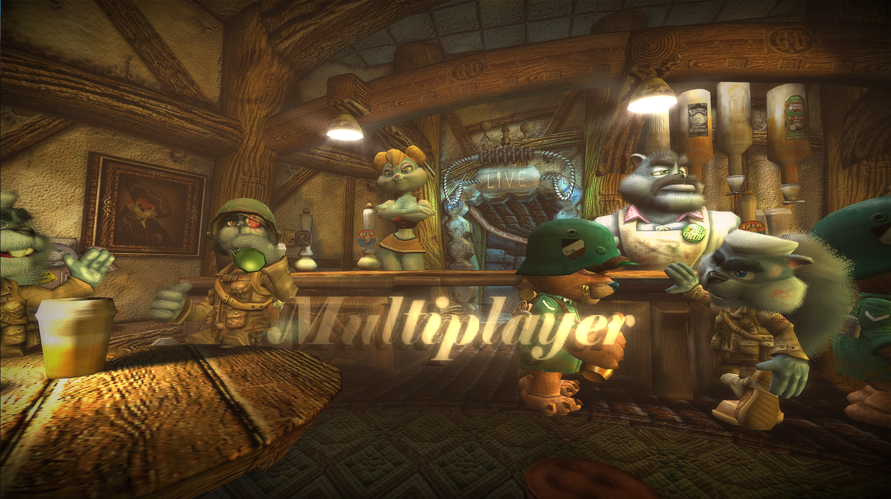</td>
  </tr>
  <tr>
    <td>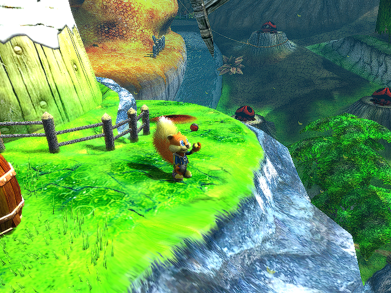</td>
    <td>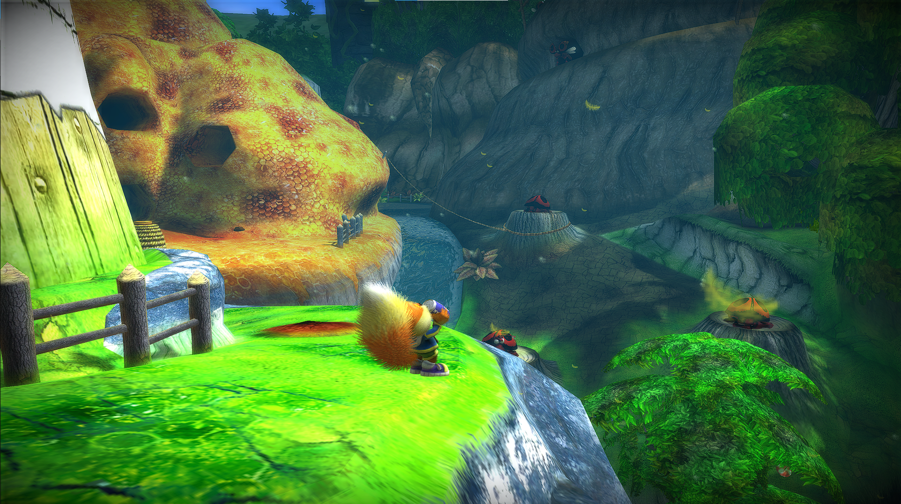</td>
  </tr>
</table>

<table>
  <tr>
    <th width="50%">Pop-in Fix off (as on the Xbox)</th>
    <th width="50%">Pop-in Fix on</th>
  </tr>
  <tr>
    <td>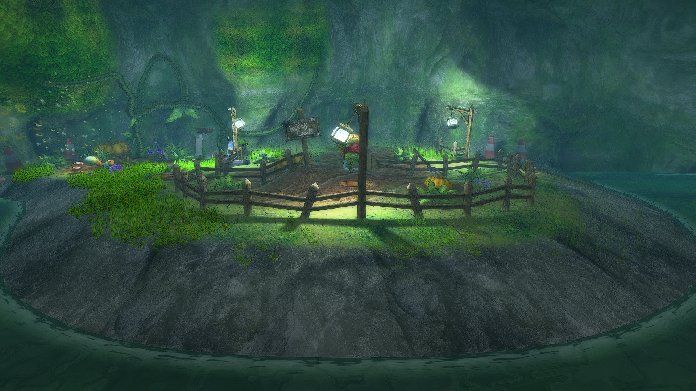</td>
    <td>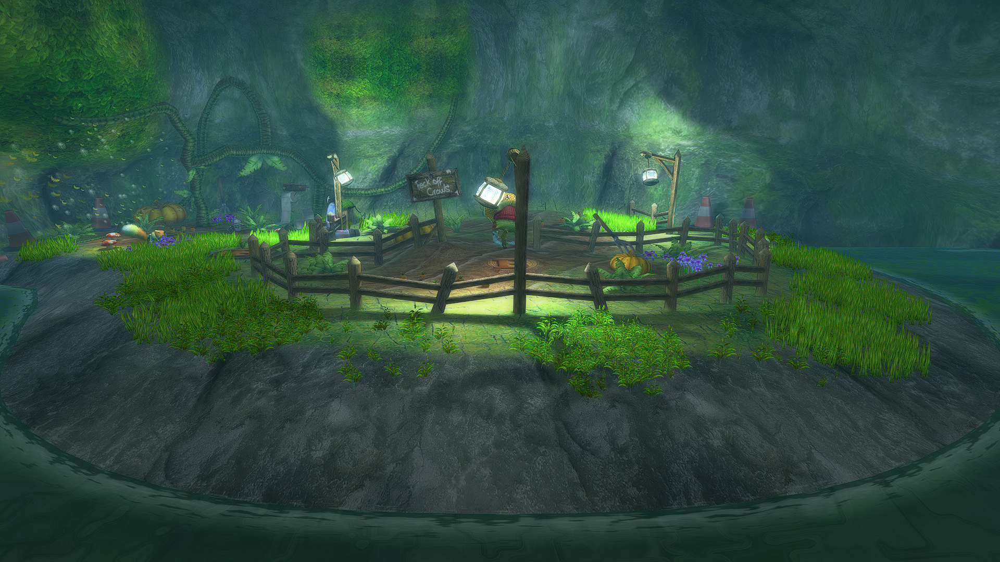</td>
  </tr>
</table>

<p align="center">
  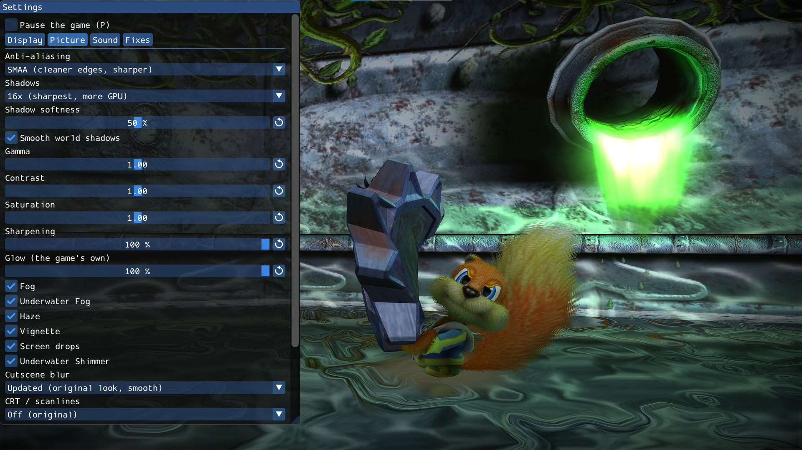<br>
  <i>The F2 settings menu, with the game running under it</i>
</p>

### Controls

- **Keyboard and mouse** with mouse look everywhere: on foot, aiming,
  swimming, flying as the bat and in vehicles. Every gameplay key can be
  changed (F3 menu or the launcher's Controls tab).
- Two single-player layouts: **Classic** (the controller one-to-one) and
  **Modern** (hold the right mouse button to aim, a separate action key).
- **PlayStation 4 and 5 controllers** (DualShock 4, DualSense) work directly,
  no extra programs. Xbox controllers of course too.
- **Slots**: choose which controller, or the keyboard, is which player.
- Multiplayer keyboard and mouse controls, with a zoom key.

<p align="center">
  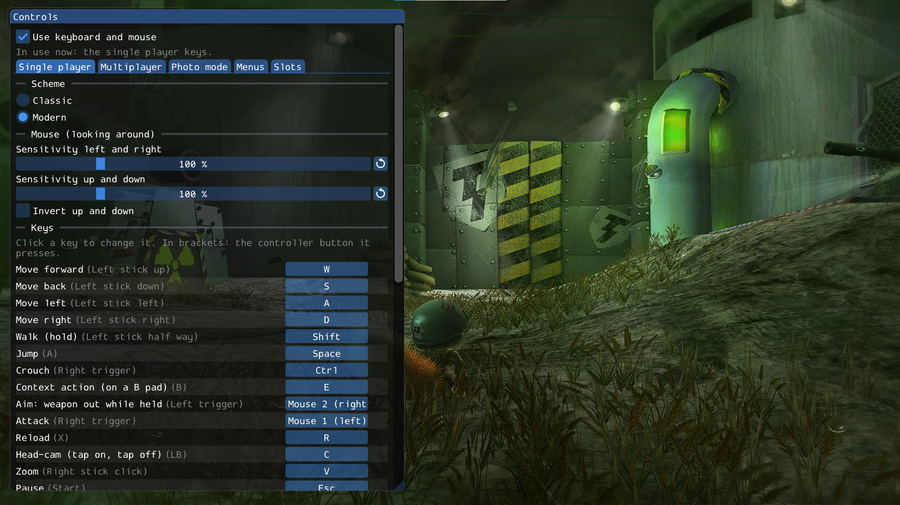<br>
  <i>The F3 controls menu</i>
</p>

### Photo mode

Press **F4** (or Back + RB) in gameplay or a cutscene to freeze the moment
and fly a free camera: zoom, roll, hide the HUD and Conker, step frame by
frame, adjust the depth of field, and take pictures (saved as PNG files).

<p align="center">
  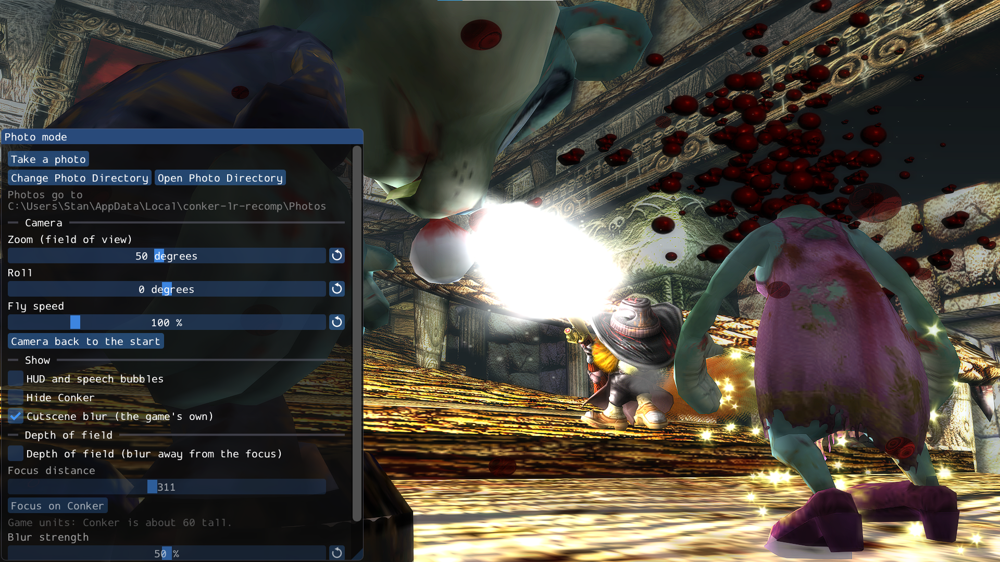<br>
  <i>The photo mode panel. Photos taken with it are in <a href="#screenshots">Screenshots</a> below.</i>
</p>

### Sound

- The Xbox's sound chip emulated as in xemu, for the original mix.
- Speaker mix and 3D sound (HRTF) options.
- Sound can be silenced while paused.

### Uncensored

With the fan-made [decensor patch](https://github.com/nastys/conker-live-and-reloaded-decensor)
(by nastys, Vaani and Theconker64; downloaded by the launcher if you want it):
cutscene voices and songs without the bleeps, and uncensored text.

<p align="center">
  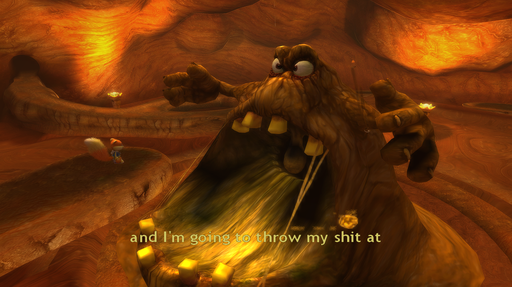<br>
  <i>The Great Mighty Poo song, uncensored</i>
</p>

### Fixes to the original game

A few glitches the Xbox version has too are fixed:

- Characters' mouths no longer stay open after quick lines of speech.
- Smoke, fire and glows no longer show through barbed wire in front of them.
- Sounds no longer end early when the game is paused.
- A character no longer lies half inside the floor in a late cutscene.
- The game keeps its normal speed when it slows down, instead of speeding up.

### The launcher

- Imports the game from a disc image, folder or archive (`.zip`, `.7z`,
  `.rar`, multi-part included), and checks it is a supported release.
- Every in-game setting and control, in tabs, before you start.
- **Updates itself**: when a new version is out, one click installs it and
  keeps your game files and patch.
- Buttons to open your saves, photos and logs.

<table>
  <tr>
    <th width="50%">Settings tab</th>
    <th width="50%">Controls tab</th>
  </tr>
  <tr>
    <td>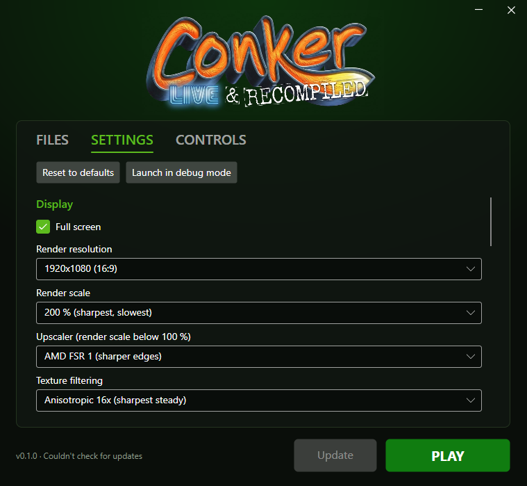</td>
    <td>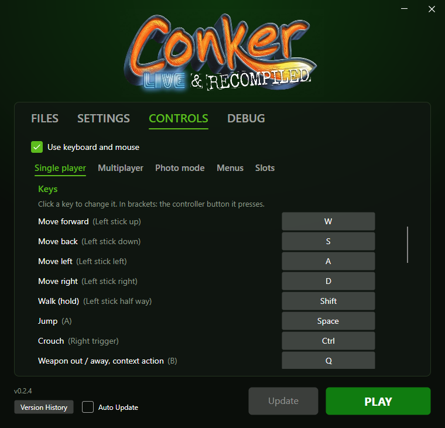</td>
  </tr>
</table>

### For modders

- **Texture replacement**: PNG files in a `textures\` folder next to the game
  replace the game's textures, matched by a hash of each texture.

---

## Requirements

- Windows 10 or 11, 64-bit
- A graphics card with DirectX 11
- Your own copy of *Conker: Live & Reloaded* (Xbox; PAL or USA)
- About 5 GB of free space
- Optional: an Xbox or PlayStation controller (keyboard and mouse work too)

Windows "N" editions need Microsoft's Media Feature Pack for the game's movies.

## Keys in the game

| Key | Controller | |
|---|---|---|
| F2 | Back + LB | Settings menu |
| F3 | | Controls menu |
| F4 | Back + RB | Photo mode |
| F11 | | Full screen on/off |
| F1 | | Frame rate counter |
| P | | Pause or resume |

Saves, settings, photos and logs are in `%LOCALAPPDATA%\conker-lr-recomp\`.

## Known issues

- Xbox Live and System Link are not available (multiplayer against bots works).
- The first time an area is seen, a short pause can happen while the graphics
  card prepares it; it is remembered for next time.
- Sound can crackle for a moment when the game slows down.
- The original loading screen doesn't show.
- Parts of It's War (the beach) can drop below 60 fps.
- Opening photo mode during a cutscene can break the cutscene's sound. For
  example, during the Great Mighty Poo song it removes the voice lines.

With the **Modern** controller layout (fixes are planned for the next update):

- If you open photo mode while aiming, Conker keeps aiming after exiting. Aim
  again to fix.
- *Heist – Enter the Vertex*: the context pads that start the slow-motion
  jumps don't work the normal way. Requires you to aim while activating, then
  release aim button. When aim button is released, Conker will then jump and
  go in slow mo. You then need to press the aim button again to fire.
- The slingshot's context pads don't react to the context button. Hold the
  aim button to use them instead, as with the other weapons. (More a quirk
  than a bug; this will become an option.)

Found something else? Please open an [issue](../../issues) and attach the
newest log (launcher → Files → Logs).

## Building from source

The recompiled game code is never published: building means running the
toolkit's pipeline on your own copy of the game, which translates its
`default.xbe` into C on your PC.

You need:

- Windows 10 or 11, 64-bit, with [Git](https://git-scm.com/)
- Visual Studio 2022 with the **Desktop development with C++** workload
  (includes CMake and Ninja)
- [Python 3.12](https://www.python.org/) and [PowerShell 7](https://github.com/PowerShell/PowerShell)
- The [.NET 10 SDK](https://dotnet.microsoft.com/) (only for the launcher)
- Your game's files: the `game\` folder the launcher imported, or the
  disc extracted with [xdvdfs](https://github.com/antangelo/xdvdfs)

Then, with `<game>` standing for the folder that holds `default.xbe`:

```bat
git clone --recurse-submodules https://github.com/cdetv/conker-live-recompiled.git
cd conker-live-recompiled
py -3.12 -m venv .venv
.venv\Scripts\python -m pip install capstone
pwsh scripts\pipeline.ps1 -GameDir <game>
```

The pipeline takes about 10 minutes and writes the C code to
`src\recomp\gen\`. Then, in an **x64 Native Tools Command Prompt for VS
2022**:

```bat
cmake -S . -B build -G "Ninja Multi-Config" -DCONKER_GAME_DIR=<game>
cmake --build build --config Release
dotnet publish launcher -c Release -o build\launcher
```

The game is `build\Release\conker.exe` (with `xemu_apu.dll` beside it; it
finds the game files through a link to `<game>`), the launcher
`build\launcher\conker-launcher.exe`. Building the game takes about 15
minutes.

## Credits

- **[xboxrecomp](https://github.com/sp00nznet/xboxrecomp)** by Ned Heller
  (sp00nznet) and contributors: the recompilation toolkit and runtime this is
  built on (used through the fork [cdetv/xboxrecomp](https://github.com/cdetv/xboxrecomp)).
- **[xemu](https://github.com/xemu-project/xemu)**: the sound chip emulation,
  and the reference the port was checked against.
- **nastys, Vaani and Theconker64**: the decensor patch.
- **codepdbh/xboxrecomp-conker**, the moddb *Conker Xbox 60fps + widescreen*
  patch, **XboxDev/ghidra-xbe** and **Ghidra**: knowledge and tools along the way.
- Dear ImGui, SDL3, AMD FidelityFX CAS and FSR 1, NVIDIA FXAA, SMAA, .NET,
  Avalonia, CommunityToolkit.Mvvm and SharpCompress.

Full licences: [`LICENSE.txt`](LICENSE.txt) (this project, MIT) and
[`THIRD_PARTY_NOTICES.txt`](THIRD_PARTY_NOTICES.txt).

## Legal

This project contains no game assets and no original game files. You must
own the game to play. *Conker: Live & Reloaded*, *Conker* and *Xbox* are
trademarks of Microsoft Corporation / Rare Ltd. This project is not
affiliated with or endorsed by Microsoft or Rare.

## Screenshots

Taken with photo mode at 1920×1080.

<table>
  <tr>
    <td width="50%">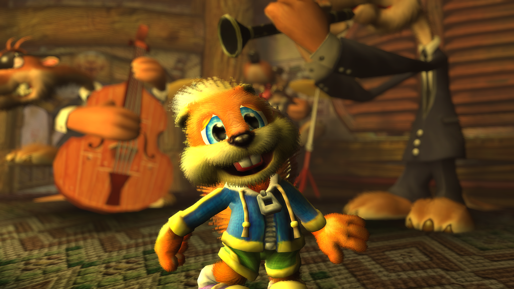</td>
    <td width="50%">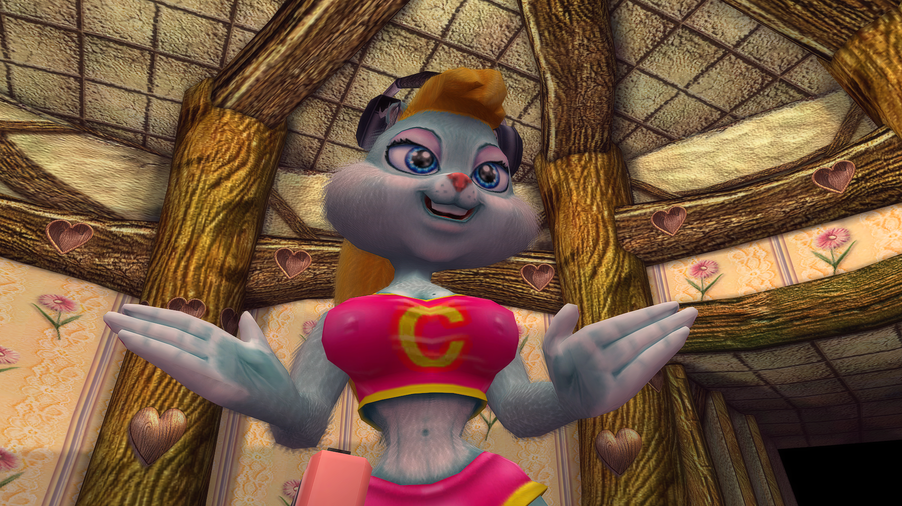</td>
  </tr>
  <tr>
    <td>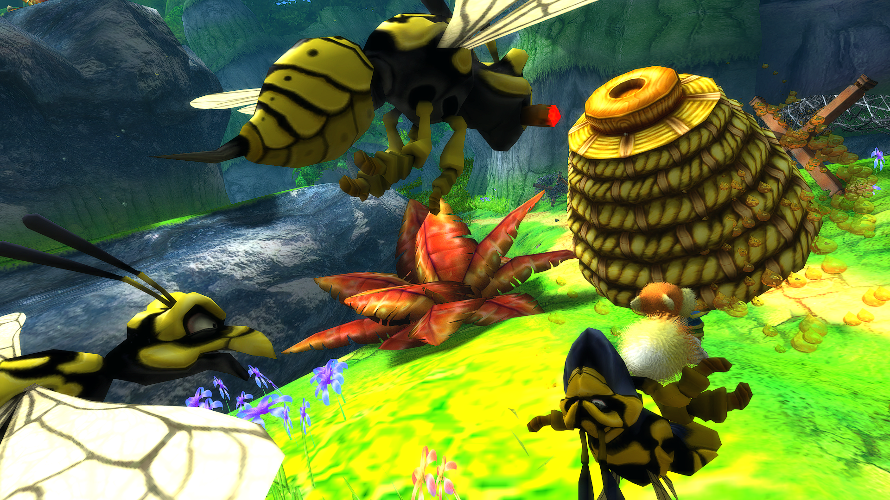</td>
    <td>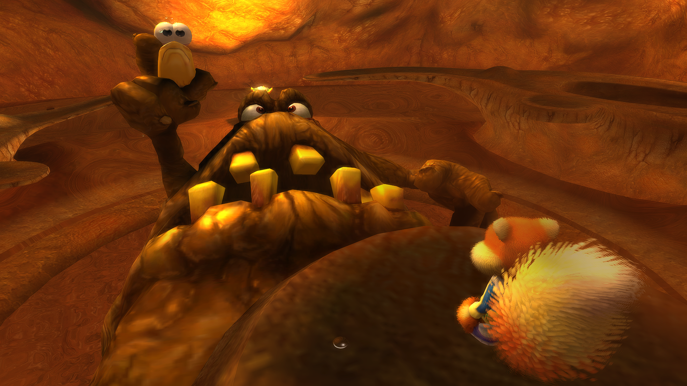</td>
  </tr>
  <tr>
    <td>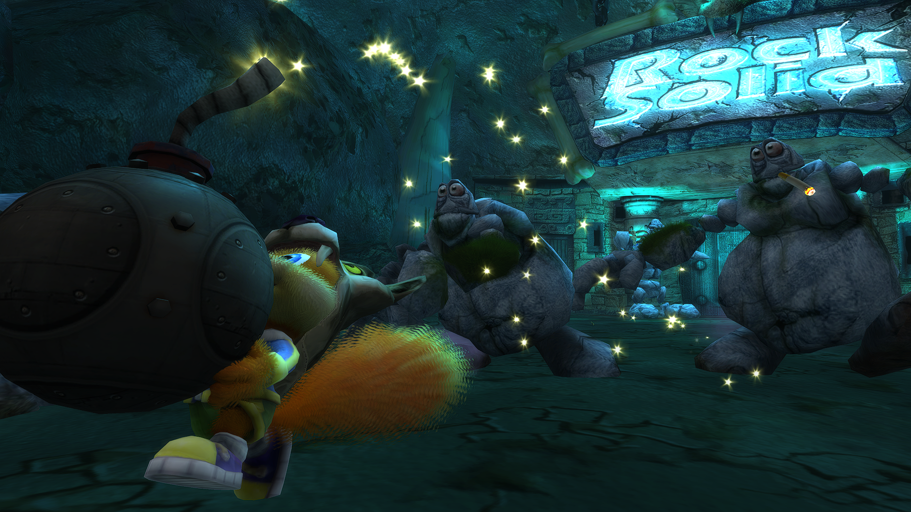</td>
    <td>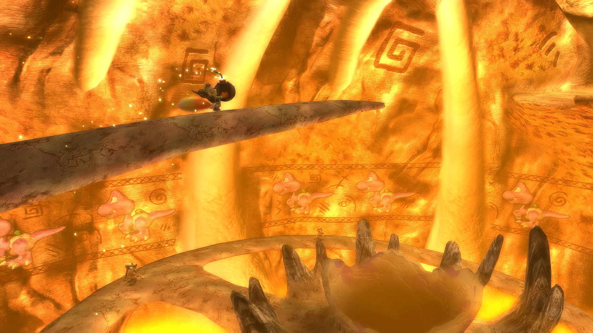</td>
  </tr>
  <tr>
    <td>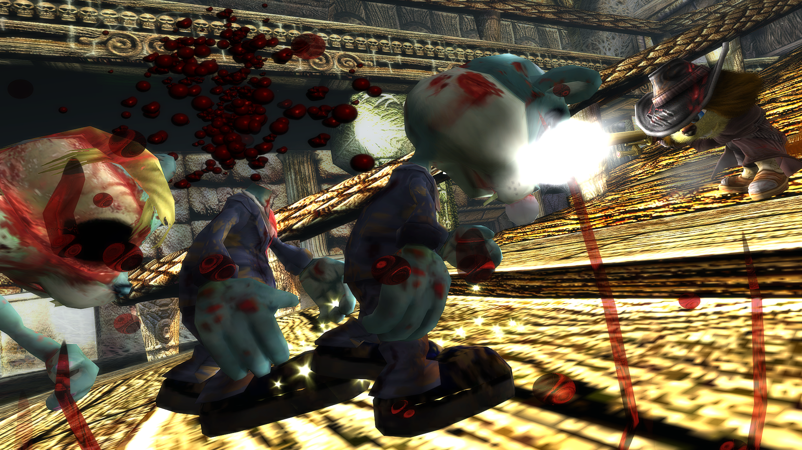</td>
    <td>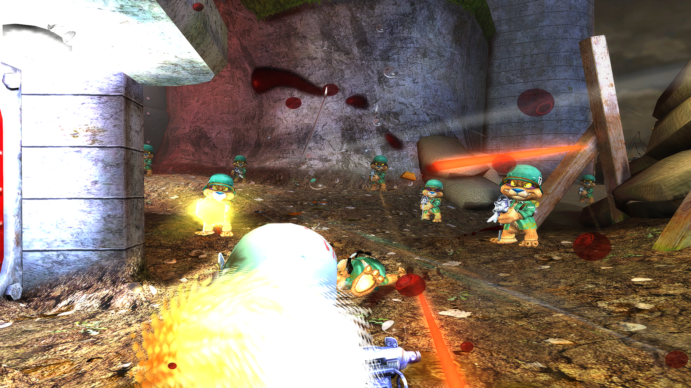</td>
  </tr>
  <tr>
    <td>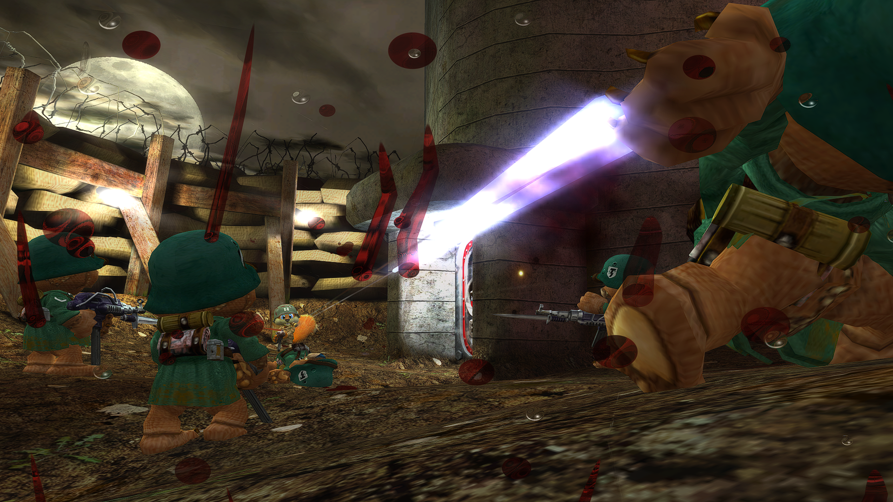</td>
    <td>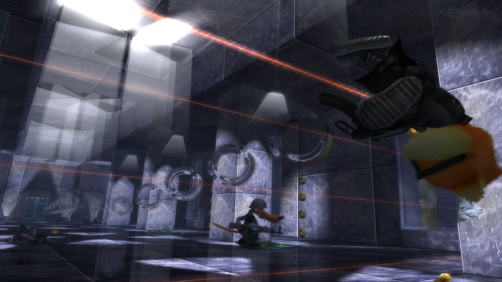</td>
  </tr>
</table>
